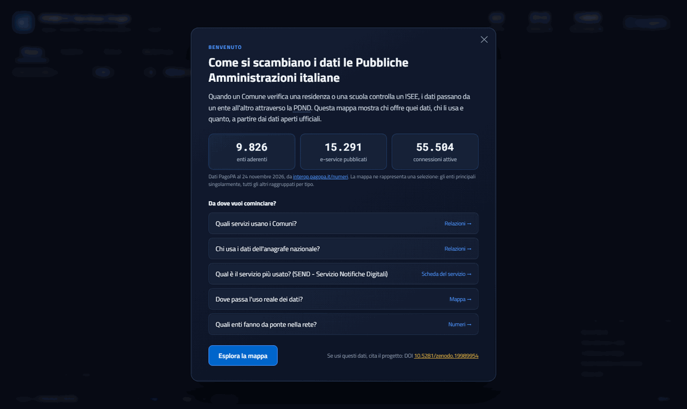
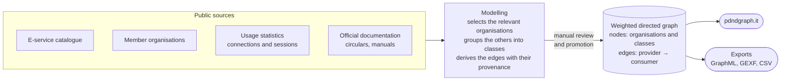

<div align="center">

[Italiano](README.md) · **English**


# PDND E-Services Graph

**Italy's interoperability network, made navigable.**

Who provides which data, to whom, and in what volumes: the National Digital Data Platform (PDND)<br>
as an interactive graph, built on official open data with the provenance of every relationship declared.

[](https://www.pdndgraph.it)
[](https://doi.org/10.5281/zenodo.19989954)

[](https://www.gnu.org/licenses/agpl-3.0)


[](https://github.com/engineering87/pdnd-eservices-graph/issues)

[](https://github.com/engineering87/pdnd-eservices-graph)



<sub>Online at **[pdndgraph.it](https://www.pdndgraph.it)**, with no installation or sign-up.</sub>

<br>

| **63** | **313** | **600** | **264** | **88.7%** |
|:---:|:---:|:---:|:---:|:---:|
| nodes, including 10 classes of organisations | e-services | provider→consumer edges | edges observed in actual use | catalogue coverage |

<sub>Model v2, snapshot of 26 November 2026. The nodes are a selection: see [What the nodes represent](#what-the-nodes-represent).</sub>

</div>

---

## In short

- **Explore** the network: more than 9,800 member organisations condensed into 53 individually represented organisations and 10 classes (Municipalities, Schools, Healthcare, Regions and the other official PagoPA categories), with their e-services.
- **Tell the evidence apart**: every edge states whether it comes from official documentation, from usage recorded by the PDND, from the catalogue, from the previous model or from an estimate.
- **Reuse the data**: the graph can be exported to GraphML, GEXF and CSV, ready for Gephi, NetworkX, R or a spreadsheet.

> [!IMPORTANT]
> **If you use this tool, cite it.** Anyone who reuses the graph, data, exports, analyses or images of PDND E-Services Graph, in a publication, a thesis, a report, a presentation or another project, must cite:
>
> **Del Re, F. (2026). *The PDND E-Service Network: A Graph-Based Model from Italian Open Government Data*. Zenodo. [doi:10.5281/zenodo.19989954](https://doi.org/10.5281/zenodo.19989954)**
>
> BibTeX and details in [How to cite](#how-to-cite).

> [!NOTE]
> **The graph is a dated snapshot.** Organisations, e-services and connections change every day. The published graph captures **26 November 2026**; the Zenodo report describes model v1 of 2 May 2026. Current figures are at [interop.pagopa.it/numeri](https://www.interop.pagopa.it/numeri). When you cite data from this project, always state the snapshot date.

## Contents

| Understand | Go deeper | Use | Take part |
|---|---|---|---|
| [Why this project](#why-this-project) | [The model](#the-model) | [Features](#features) | [Contributing](#contributing) |
| [What the graph shows](#what-the-graph-shows) | [Sources and provenance](#sources-and-provenance) | [Data export](#data-export) | [**How to cite**](#how-to-cite) |
| | [Data updates](#data-updates) | [Development](#development) | [License](#license) |

## Why this project

The PDND is the backbone of interoperability between Italian public administrations. It enables secure, standardised data exchange through APIs and puts the *once only* principle into practice: the public administration does not ask citizens and businesses for data it already holds.

As of 24 November 2026, PagoPA reports **9,826 member organisations**, **15,291 e-services**, **55,504 connections** and **1.87 billion exchange sessions**. At this scale it is hard to see the big picture. Who provides which services? Who consumes them? How interconnected is the network?

The project makes that network **visible and navigable** for anyone who wants to understand how data flows through the public administration: civil servants, developers, researchers, citizens.

The PDND open datasets publish the e-service catalogue and statistics on connections and sessions by category of organisation, but not the individual provider–consumer pairs. The graph reconstructs those relationships from the available public sources and states where each one comes from. The project also aims to encourage publishing those pairs as open data.

## What the graph shows

Values computed on model v2 and reproducible with `npm run audit`; the v1 value is in brackets. They describe the model, not the full set of member organisations.

**The network is highly asymmetric.** ANPR (Ministry of the Interior) provides to 53 of the 62 other nodes (v1: 34 of 50) and consumes from 12: the profile of a provider hub. At the opposite end, Comune di Roma, Comune di Napoli and every class of organisations except Municipalities have an out-degree of zero: they only consume.

**Three providers carry almost a quarter of the network.** ANPR, INPS and Agenzia delle Entrate account for 22.5% of the 600 edges (v1: 24.5% of 343). The density is 0.1536, about one sixth of the possible connections between the represented nodes: interoperability still runs through a few central hubs.

**Some organisations are hinges, not endpoints.** INPS provides to 50 nodes and consumes from 36: it sits at the centre of welfare both as a source and as a consumer. The Municipalities node shows the complementary pattern, with 43 incoming and 14 outgoing edges, as expected from a node that gathers thousands of consuming organisations.

**Enablement and use are different measures.** A certified edge says that a class of organisations can use a service; an observed edge says that it does. In the model there are 630 of the former and 264 of the latter. Observed edges show where the volumes go, for example more than 150 million sessions from ANPR services to Municipalities. The official rankings only list the top 10 e-services per category, though, so a service without an observed edge is not necessarily little used.

**Thematic clusters match the domains of the public administration.** Already in model v1, welfare (INPS, Municipalities, Ministry of Labour), tax (Agenzia delle Entrate, MEF, Sogei) and transparency (ANAC, AgID) separated in the layout, without the categories being used to place the nodes.

High-centrality nodes are those whose unavailability would affect many other organisations. A density that grows over time would indicate that interoperability is spreading across more organisations instead of concentrating.

## Features

**First visit**
- Welcome screen with the official PDND figures and ready-made questions ("Quali servizi usano i Comuni?" (Which services do Municipalities use?), "Qual è il servizio più usato?" (Which is the most used service?)…)
- **Il progetto** (The project) window explaining what the map shows, how to read it and how to cite it
- Technical terms explained in one line on mouse hover or tap, and a glossary in the **Guida** (Guide) tab

**Exploration**
- Interactive force-directed graph: drag nodes, zoom with the mouse wheel, pan the view
- Readable map: nodes that do not overlap, non-overlapping labels that get denser as you zoom, automatic fit to the screen and a **Centra** (Centre) button, colour legend by family
- Filter by category from the legend and text search for organisations
- Details panel with the e-services each organisation provides and consumes and, for classes, the number of members
- Direct links to every view and every organisation, for example [pdndgraph.it/ente/inps](https://www.pdndgraph.it/ente/inps)

**Accessibility and themes**
- Light and dark theme, with a button in the header; on the first visit it follows the system preference
- Text colours checked against WCAG 2.1 AA contrast (at least 4.5:1) in both themes
- Keyboard use: a "skip to content" link, organisation search with suggestions that opens the result with Enter, dialogs that keep focus inside and close with Esc
- Respects the "reduce motion" preference; tables declare their headers for screen readers

**Relationships between organisations** (the **Relazioni** (Relations) tab)
- All provider → e-service → consumer relationships in a table, filterable by provider, consumer, category, provenance and text
- Summary grouped by provider, consumer, category, e-service or provenance, with enabled organisations and observed sessions
- Ready-made paths ("Cosa usano i Comuni" (What Municipalities use), "Chi usa i servizi ANPR" (Who uses ANPR services)…), filtered views shareable by link and CSV download
- A page for every e-service ([example](https://www.pdndgraph.it/eservice/pagopa_cfc8a94d)): provider, consumers by provenance, enabled organisations and sessions, catalogue identifier, other services from the same provider

**Reading the data**
- Directional provider→consumer arrows, with thickness proportional to the shared services
- Colours by institutional family: Ministry, Region, Social security, Tax, Digital and others
- Visible provenance: observed edges in light blue, reconstructed and inferred edges dashed
- Filter by provenance, from the menu or the legend: for example only observed use ([pdndgraph.it/?archi=osservata](https://www.pdndgraph.it/?archi=osservata)) or only official sources
- Enabled organisations and exchange sessions for e-services, where the official data report them

**Figures and export** (the **Numeri** (Figures) tab)
- PDND trend since 2022: member organisations and exchange sessions month by month, with the official totals and the change over the last month
- Trend for individual services: sessions over the last 12 and 6 months and comparison with the previous 6 months, on each e-service page and in the growing or declining services
- **Cosa è cambiato** (What changed): comparison of the current graph with the monthly snapshots (since 1 June 2026) or with model v1 of the report: new links, removed links, services added and removed, services with the most new sessions
- Most adopted and most used e-services, edges by provenance, classes of organisations
- Network analysis: matrix of providers × classes of organisations reached, bridge organisations (betweenness centrality), reciprocity and degree distribution
- Export to GraphML, GEXF and CSV directly from the browser
- **Metodologia** (Methodology) and **Guida** tabs built into the app

## The model

### In numbers

| Metric | v2 (26 November 2026) | v1 (2 May 2026, report) |
|---|---|---|
| Nodes | **63** (53 organisations + 10 classes of organisations) | 51 (50 organisations + 1 aggregate) |
| E-services | **313** | 86 service types |
| Distinct provider→consumer edges | **600** | 343 |
| Provider–consumer relationships | **1,476** | 570 |
| Density | **0.1536** | 0.1345 |
| Coverage of the official catalogue | **88.7%** of 15,301 records | ~89% of 14,102 endpoints |

By role: 48 nodes that both provide and consume, 12 consumers only, 3 providers only. By category: 21 Region, 8 Aggregated classes, 7 Ministry, 6 Municipality, 4 Tax, 2 each Digital, Transport, Technology, Statistics and Public company, 1 each Social security, Labour, Business, Anti-corruption, Culture, Aggregated Municipalities and Aggregated Regions.

### What the nodes represent

> [!IMPORTANT]
> **63 is not the number of organisations that have joined the PDND**, which are almost 10,000: it is the number of nodes in a model that selects some organisations and aggregates all the others.

| | What it contains |
|---|---|
| **53 individual nodes** | Ministries, social security and tax agencies, authorities, public companies, 21 Regions and Autonomous Provinces, 6 large Municipalities |
| **10 classes of organisations** | All other members, grouped by official PagoPA category |

| Class | Members | | Class | Members |
|---|---:|---|---|---:|
| Municipalities (Comuni) | 7,657 | | Private organisations (Enti privati) | 306 |
| Central public administrations (PA centrali) | 415 | | Universities and AFAM (Università e AFAM) | 172 |
| Schools (Scuole) | 381 | | Healthcare (Sanità) | 123 |
| Other local public administrations (Altre PA locali) | 350 | | Provinces and Metropolitan Cities (Province e Città metropolitane) | 99 |
| Public service operators and contracting authorities (Gestori di pubblici servizi e stazioni appaltanti) | 343 | | Regions (Regioni) | 21 |

**Aggregation.** Most catalogue endpoints are standard services replicated by every Municipality: Albo Pretorio, SUAP, Protocollo, Demografici, Tributi, Civici, WaaS, IoT, Trasparenza. The 9 e-services assigned to the Municipalities node correspond to about 6,380 catalogue endpoints. Representing them one by one would produce thousands of near-identical nodes without adding any information about the structure of the network. The same rule applies to consumers: a category of organisations declared by the catalogue or by the official statistics goes on the class node, never on a sample of organisations chosen by the project.

**Selection.** The catalogue lists more than 6,000 distinct producers. The model represents 53 of them individually, chosen for their role in the network: the national provider hubs (all 10 providers with the most official connections are included), organisations with a structural role in the domains of the public administration, the Regions and Autonomous Provinces, and the Municipalities that provide their own services.

Degree, centrality and density are therefore computed **on this set**, not on the full set of members: an out-degree of 53 means "provides to 53 of the 62 other nodes", some of which represent thousands of organisations. They are indicators of the structure of the represented network, not a census. Full criteria in [METODOLOGIA.md §3](METODOLOGIA.md#3-scelte-di-rappresentazione-e-aggregazioni) (in Italian) and [§7.2](METODOLOGIA.md#72-classi-di-enti).

> [!NOTE]
> 55 of the 313 records in `eservices`, those without a `catalogId`, represent a **service type** from model v1 and not a single catalogue endpoint. See [METODOLOGIA.md §3.5](METODOLOGIA.md#35-tipi-di-servizio-service-type-vs-endpoint-del-catalogo).

### How the graph is built

From the platform's open data to the graph, in four steps:



Interoperability is a network problem: parties that produce data and parties that consume it, linked by agreements and interfaces. A list answers the question "which services exist"; a graph also answers "what shape does the resulting network have".

The model is a **weighted directed graph**: an edge from A to B means that A provides at least one e-service consumed by B, and the weight counts the services shared by the pair. Direction matters: INPS providing to Municipalities does not imply the reverse.

The visualisation uses a force-directed layout (Fruchterman-Reingold), which arranges the nodes as a system of springs and repulsions until it reaches equilibrium: the topology emerges without manual positioning. The formulas for degree, centrality and density are in [METODOLOGIA.md](METODOLOGIA.md).

## Sources and provenance

| Data | Source | Nature |
|---|---|---|
| Organisations | [`aderenti.csv`](https://github.com/italia/pdnd-opendata), dati.gov.it | ✅ Official open data |
| E-services | [`eservice_a_catalogo.csv`](https://github.com/italia/pdnd-opendata), dati.gov.it | ✅ Official open data |
| Adoption and use | [Rankings of enabled organisations and sessions](https://github.com/italia/pdnd-opendata) by category of organisation, `totale_enti.csv` | ✅ Official open data, aggregated |
| Relationships (edges) | Official rankings, `attributes.certified` field, circulars, operating manuals | ⚠️ Reconstruction with per-edge provenance |

> [!CAUTION]
> **Individual pairs are not open data.** The PDND publishes connections and sessions only aggregated by category of consuming organisation: these are the source of the *observed* edges to classes of organisations, with values that are guaranteed minimums. The other relationships are reconstructed from the catalogue's `attributes.certified` field and from public official documentation: ANPR DAIT circulars no. 73/2023 and no. 61/2025, the ANCI/DTD presentation on the 26 use cases, the Unioncamere SSU operating manual, I.PaC documentation, technical briefs.

Each edge carries an `origine` field, so users of the data know where each relationship comes from. When more than one source supports the same edge, the strongest one applies, in the order of the table:

| Origin | Meaning | Edges |
|---|---|---:|
| `documentata` | Specific official source: laws, circulars, manuals, presentations | 12 |
| `osservata` | Connections or sessions actually recorded by the PDND to a class of organisations | 264 |
| `certificata` | Class of organisations enabled by the catalogue's `attributes.certified` field | 630 |
| `ricostruita` | Relationship from model v1, reconstructed from public documentation without a per-edge source | 545 |
| `inferita` | Frozen AI estimate, used only when no other evidence exists | 25 |

Of the 570 relationships in v1, all retained, 25 are confirmed by official data (18 certified, 7 observed). Inferred edges are estimates, not documented facts; all the project's sources are public. Full methodology in [METODOLOGIA.md](METODOLOGIA.md), model v2 in [section 7](METODOLOGIA.md#7-modello-v2-novembre-2026).

## Data updates

The catalogue grows as new organisations join and new e-services are published, statuses switch between Active and Suspended, and API versions follow one another. To keep automation separate from the published data, the project maintains three levels:

| Level | File | Updated to | Content |
|---|---|---|---|
| **Live graph** (v2) | `src/data/pdnd-data.json` | 26 November 2026 | 63 nodes, 313 e-services, 600 edges |
| **Preview** (automatic) | `pipeline/pdnd-data.preview.json` | 26 November 2026 | aligned with the live graph |
| **v1 snapshot** (report) | `src/data/snapshots/pdnd-data.2026-05-02.json` | 2 May 2026 | 51 nodes, 86 e-service types, 343 edges, frozen |

A monthly GitHub Action regenerates the preview and opens a pull request on `develop` with the run report. The preview **does not replace** the live graph: promotion is manual, goes through a separate pull request and reaches the site with the release. This way an automatic change in the catalogue cannot delete relationships that were reconstructed and documented by hand. The 570 v1 relationships live in `pipeline/connections-reconstructed.json` and flow into every preview; a test checks that no v1 provider→consumer pair is lost.

For each organisation the pipeline picks the most relevant e-services according to the official rankings, that is the larger of enabled organisations and exchange sessions; the `enti_abilitati_min` and `sessioni_min` fields report their guaranteed minimums. Each consumer appears once per e-service, with the strongest provenance; observed connections and sessions accompany the edge whatever its provenance.

```bash
node pipeline/build-graph-data.mjs           # dry run: downloads, computes, prints the report
node pipeline/build-graph-data.mjs --write   # updates the preview, the live graph stays untouched
node pipeline/build-graph-data.mjs --no-ai   # without inference
npm run compare-catalog                      # model coverage against the live catalogue
```

The run report (`pipeline/last-run-report.md`) lists the number of catalogue rows, new and removed e-services, edges by provenance, classes of organisations with their members, and curated e-services that are no longer published.

**Assisted inference.** AI estimates are frozen in `pipeline/connections-frozen.json`: every build is deterministic and calls no model. Runtime inference runs only on the `catalogId` values listed in `pipeline/inference-allowlist.json`, which is empty by default, with a controlled vocabulary (existing nodes only), a confidence threshold (`INFERENCE_MIN_CONF`, default 0.55), a cache per `catalogId`, temperature 0, and fallback to no AI if the API does not respond. Variables and details in [pipeline/README.md](pipeline/README.md) (in Italian).

## Data export

The model is available in standard network analysis formats, so there is no need to parse the project's JSON. The files are in the [`exports/`](exports/) folder, which can be regenerated with `npm run export`, and can also be downloaded from the **Numeri** tab of the app, which generates them in the browser without network calls.

| Format | File | Opens with |
|---|---|---|
| GraphML | `pdnd-eservices-graph-graphml.graphml` | Gephi, NetworkX, igraph, yEd |
| GEXF | `pdnd-eservices-graph-gexf.gexf` | Gephi |
| Nodes CSV | `pdnd-eservices-graph-nodi-csv.csv` | Spreadsheets, R, pandas |
| Edges CSV | `pdnd-eservices-graph-archi-csv.csv` | Spreadsheets, R, pandas |

The graph is **directed and weighted**: an edge from *a* to *b* means that *a* provides at least one e-service consumed by *b*, and the weight is the number of distinct e-services on the pair, as in the published report.

<details>
<summary><b>Node and edge attributes</b></summary>

**Nodes**

| Field | Type | Meaning |
|---|---|---|
| `label` | string | Name of the organisation |
| `categoria` | string | Institutional family (Ministry, Region, Tax, ...) |
| `tipo` | string | Main role: provider, consumer or both |
| `aggregato` | boolean | `true` if the node represents a class of organisations |
| `aderenti` | integer | Number of member organisations in the class (aggregated nodes only) |
| `descrizione` | string | Descriptive note |

**Edges**

| Field | Type | Meaning |
|---|---|---|
| `weight` | integer | Number of distinct e-services on the edge |
| `origine` | string | Provenance: `documentata`, `osservata`, `certificata`, `ricostruita` or `inferita`; if there is more than one provenance they are separated by `\|` |
| `connessioni` | integer | Enabled organisations observed on the pair (maximum across e-services), guaranteed minimum |
| `sessioni` | integer | Exchange sessions observed on the pair (sum across e-services), guaranteed minimum |
| `servizi` | string | Names of the e-services that contribute to the weight, separated by `;` |

</details>

> [!WARNING]
> Two caveats, also repeated in the file metadata. Individual provider-consumer pairs **are not published as open data**: the edges derive from aggregated statistics, the catalogue and documentation, and the `origine` field states their nature. Nodes with `aggregato=true` represent classes of organisations (`comuni_agg` stands for about 7,650 Municipalities): degree measures **are not comparable** with those of a graph in which each organisation is a separate node. To exclude them, filter on that field.

<details>
<summary><b>Examples with NetworkX and pandas</b></summary>

```python
import networkx as nx

G = nx.read_graphml("pdnd-eservices-graph-graphml.graphml")
print(G.number_of_nodes(), G.number_of_edges())   # 63 600
print(round(nx.density(G), 4))                    # 0.1536

# Organisations that serve the largest number of counterparts
for n, d in sorted(G.out_degree, key=lambda x: -x[1])[:3]:
    print(G.nodes[n]["label"], d)
# Min. Interno (ANPR) 53
# INPS 50
# Agenzia delle Entrate 32

# Subgraph without the aggregated nodes, for comparable degree measures
reale = G.subgraph([n for n, d in G.nodes(data=True) if not d["aggregato"]])
print(reale.number_of_nodes(), reale.number_of_edges())   # 53 376
```

```python
import pandas as pd

archi = pd.read_csv("pdnd-eservices-graph-archi-csv.csv")
nodi  = pd.read_csv("pdnd-eservices-graph-nodi-csv.csv")

# Edge breakdown by provenance
print(archi["origine"].value_counts())

# Organisations by total number of services provided
nome = nodi.set_index("id")["label"]
print(archi.groupby("Source")["Weight"].sum().sort_values(ascending=False).head(3).rename(index=nome))
# Min. Interno (ANPR)      267
# INPS                     140
# Agenzia delle Entrate    101
```

In **Gephi**, open the `.gexf` file, or import the two CSV files from the Data Laboratory: the edge header already uses `Source`, `Target`, `Weight`, `Type`.

</details>

The exports are **deterministic**: with the same data the files are byte-for-byte identical, because the snapshot date is read from the model and not from the clock. The tests check that the files in `exports/` match the current data. Source data CC0 1.0, code AGPL-3.0; if you use these files in a publication, [cite the project](#how-to-cite).

## Development

### Quick start

```bash
git clone https://github.com/engineering87/pdnd-eservices-graph.git
cd pdnd-eservices-graph
npm install
npm run dev        # http://localhost:3000
```

| Command | What it does |
|---|---|
| `npm run dev` / `npm run build` | Development server / production build |
| `npm run lint` | Static code analysis |
| `npm test` | Model invariants, v1 retention, export alignment |
| `npm run audit` | JSON audit: counts, degrees, consistency checks |
| `npm run compare-catalog` | Model coverage against the official catalogue |
| `npm run export` | Regenerates GraphML, GEXF and CSV in `exports/` |
| `npm run update-data` | Summary of the PDND catalogue, useful to discover new providers |
| `npm run paper-metrics` | pgfplots/LaTeX snippets for the Zenodo report |

Details on the scripts in [scripts/README.md](scripts/README.md).

The build (`npm run build`) also writes a page for every organisation and e-service with its own title, description and preview image (`scripts/prerender-meta.mjs`), so shared links show the right content even to services that do not run JavaScript.

### Updating organisations and relationships

The live graph is generated by the pipeline: lasting changes go in the files in `pipeline/`, not directly in `src/data/pdnd-data.json`, which would be overwritten at the next promotion.

- **New organisation**: an entry in `pipeline/entities.json` with its IPA codes ([format](pipeline/README.md#aggiungere-unentità-tracciata)); for a new category, the colour in `src/constants/colors.js`.
- **New class of organisations**: an entry in `pipeline/classi.json`.
- **New documented relationship**: the `catalogId` of the e-service with the consumer nodes in `pipeline/connections-overrides.json`, citing the public source. Edges added this way have origin `documentata`.

```bash
node pipeline/build-graph-data.mjs --write                  # updates the preview
cp pipeline/pdnd-data.preview.json src/data/pdnd-data.json  # promotion
npm run export && npm test
```

### Project structure

<details>
<summary>Folder tree</summary>

```
pdnd-eservices-graph/
├── .github/workflows/
│   ├── azure-static-web-apps-polite-plant-07967ad10.yml  # CI/CD for Azure
│   ├── ci.yml                                            # Lint, test and build (main and develop)
│   ├── codeql.yml                                        # CodeQL security analysis (main and develop)
│   ├── dependabot.yml                                    # (in .github/) dependency updates on develop
│   ├── update-graph-data.yml                             # Monthly data pipeline
│   └── promote-graph-data.yml                            # Manual promotion of the preview
├── docs/
│   └── demo.gif
├── exports/                             # GraphML, GEXF, CSV (npm run export)
├── pipeline/                            # ← Automatic catalogue update
│   ├── build-graph-data.mjs             # Graph build script
│   ├── infer-connections.mjs            # Inference engine (off by default)
│   ├── entities.json                    # Registry of tracked entities (IPA codes)
│   ├── classi.json                      # Classes of organisations (aggregated nodes)
│   ├── category-map.json                # attributes.certified → nodes map
│   ├── connections-overrides.json       # Documented connections
│   ├── connections-reconstructed.json   # Model v1 relationships
│   ├── connections-frozen.json          # Frozen AI estimates
│   ├── pdnd-data.preview.json           # Generated preview (NOT the live data)
│   ├── last-run-report.md               # Report of the last run
│   └── README.md
├── public/                              # favicon and logo
├── scripts/                             # audit, comparison, tests, export, report metrics
├── src/
│   ├── components/                      # PDNDGraph, GraphView, StatsView, MethodologyView, GuideView…
│   ├── constants/colors.js              # Category palette
│   ├── utils/                           # Graph construction, exports, URL state
│   ├── data/
│   │   ├── pdnd-data.json               # ← LIVE DATA (model v2)
│   │   └── snapshots/                   # Report model v1 and monthly snapshots
│   ├── App.jsx
│   ├── index.css
│   └── main.jsx
├── index.html
├── package.json
├── staticwebapp.config.json             # Azure Static Web Apps config
├── vite.config.js
├── ADDITIONAL-TERMS.md                  # AGPL 7(b) attribution term
├── CITATION.cff
├── METODOLOGIA.md                       # ← Sources, methodology, limitations
└── README.md
```

</details>

### Technologies

**React 19** for the interface, **Vite 8** for the build, **Canvas 2D** for rendering the graph without external libraries, **Azure Static Web Apps** for hosting and **GitHub Actions** for CI, CodeQL analysis and the monthly data pipeline.

## Contributing

Pull requests are welcome, especially corrections to provider→consumer relationships accompanied by a reference to the public source that documents them.

1. Fork the repository and create a branch (`git checkout -b feature/nuovo-ente`)
2. Edit the files in `pipeline/` or the components
3. Run `npm run lint`, `npm test` and `npm run audit`
4. Open a pull request

## How to cite

**Every use of the project must be accompanied by a citation of the technical report**, also stating the snapshot date of the data used.

The methodology is documented in the technical report, released under the CC-BY-4.0 licence, which describes model v1: sources, reconstruction pipeline, the role of language models as an extraction tool, and measured coverage (~89% of 14,102 endpoints). The LaTeX source is in [pdnd-graph-paper](https://github.com/engineering87/pdnd-graph-paper).

> Del Re, F. (2026). *The PDND E-Service Network: A Graph-Based Model from Italian Open Government Data*. Zenodo, v1.0.0, 3 maggio 2026. [doi:10.5281/zenodo.19989954](https://doi.org/10.5281/zenodo.19989954)

```bibtex
@techreport{delre2026pdnd,
  author      = {Del Re, Francesco},
  title       = {The {PDND} E-Service Network: A Graph-Based Model from
                 Italian Open Government Data},
  institution = {Zenodo},
  year        = {2026},
  month       = {5},
  doi         = {10.5281/zenodo.19989954},
  url         = {https://doi.org/10.5281/zenodo.19989954},
  version     = {1.0.0}
}
```

GitHub also generates the citation from the **Cite this repository** button, based on [`CITATION.cff`](CITATION.cff). The figures in the report refer to model v1, those in this README to model v2: always state the snapshot date you use.

> [!NOTE]
> **What the citation is based on.** The report is under **CC-BY-4.0**: anyone who reuses its content must attribute it to the author. The code is under **AGPL-3.0**: anyone who uses or modifies it must keep the copyright and licence notices and release derivative works under the same licence. Citing the report is how the author asks for every use of the project to be acknowledged, and it lets readers trace the methodology and its limits.

## License

The code is released under the **AGPL-3.0** licence (see [LICENSE](LICENSE)), with an additional attribution term under section 7(b) (see [ADDITIONAL-TERMS.md](ADDITIONAL-TERMS.md)):

- you can freely **use, modify and distribute** the code;
- if you **distribute a modified version**, you must make it available under the same licence;
- if you **offer it as a network service** (for example a web app), you must make the source code of the running version available to its users;
- in every copy, modified version or network service you must **keep the attribution to the author and the citation of the report**, in the code and in the footer of the interface.

The e-service data come from [PDND Open Data](https://github.com/italia/pdnd-opendata) and are released under the **CC0 1.0 Universal** licence (public domain) by the Presidency of the Council of Ministers – Department for Digital Transformation.
