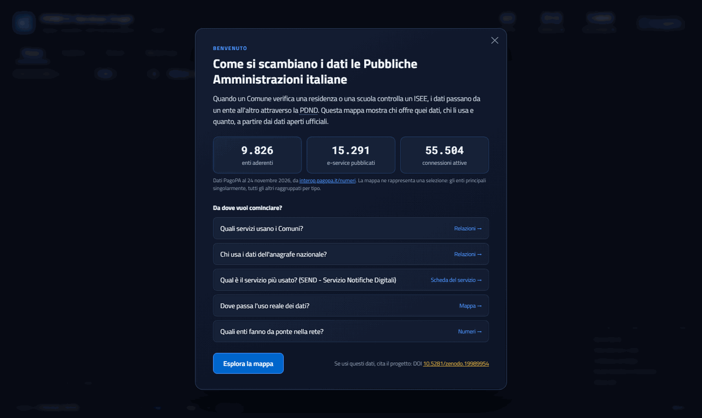
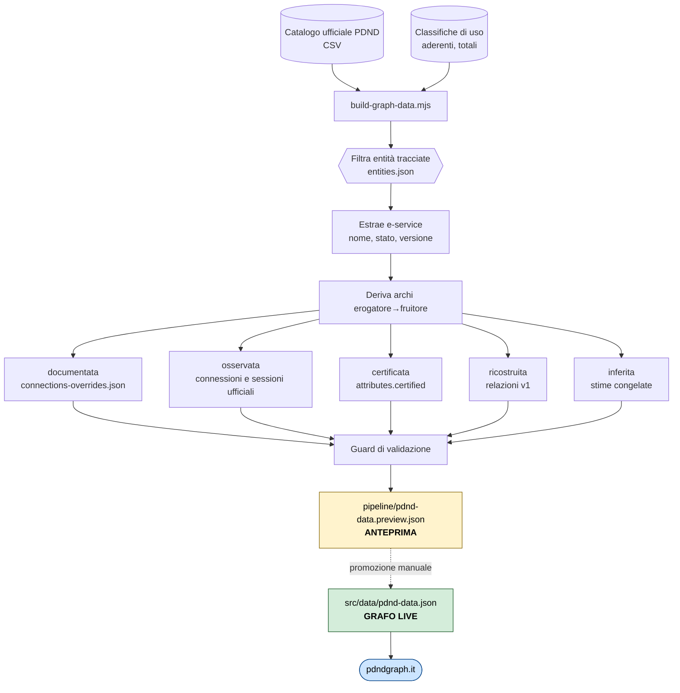

<div align="center">


# PDND E-Services Graph

**La rete dell'interoperabilità italiana, resa navigabile.**

Visualizzazione interattiva del grafo degli e-service sulla Piattaforma Digitale Nazionale Dati.<br>
I nodi sono gli enti, gli archi le relazioni erogatore→fruitore, lo spessore il numero di servizi condivisi.

[](https://www.pdndgraph.it)
[](https://doi.org/10.5281/zenodo.19989954)

[](https://www.gnu.org/licenses/agpl-3.0)
[](https://github.com/engineering87/pdnd-eservices-graph/issues)


[](https://github.com/engineering87/pdnd-eservices-graph)



<sub>Applicazione pubblica su **[pdndgraph.it](https://www.pdndgraph.it)**, senza installazione né autenticazione.</sub>

</div>

---

<div align="center">

**63** nodi (53 enti + 10 classi aggregate) &nbsp;·&nbsp; **312** e-service &nbsp;·&nbsp; **600** archi &nbsp;·&nbsp; densità **0,1536** &nbsp;·&nbsp; copertura **~89%** del catalogo

<sub>I nodi sono una selezione editoriale, non l'intero insieme degli enti aderenti. Vedi [Cosa rappresentano i nodi](#cosa-rappresentano-i-nodi). Il report Zenodo descrive il modello v1 di maggio 2026 (51 nodi, 86 tipi di e-service, 343 archi), conservato in `src/data/snapshots/`.</sub>

</div>

---

> [!IMPORTANT]
> **La PDND è un ecosistema dinamico.** Enti aderenti, e-service pubblicati, e connessioni attive cambiano di continuo. Questo grafo è una **fotografia datata**, non uno specchio in tempo reale della piattaforma.
>
> | | Riferimento |
> |---|---|
> | Snapshot del grafo pubblicato | **25 novembre 2026** (modello v2) |
> | Snapshot del report Zenodo | 2 maggio 2026 (modello v1) |
> | Numeri PDND in tempo reale | [interop.pagopa.it/numeri](https://www.interop.pagopa.it/numeri) |
> | Catalogo ufficiale e-service | [api.gov.it](https://api.gov.it) |
>
> Per l'ordine di grandezza della crescita: lo snapshot di maggio registra 14.102 API pubblicate, mentre il download della pipeline del 25 novembre riporta 15.301 righe di catalogo. Chi cita numeri tratti da questo progetto dovrebbe indicare sempre la data dello snapshot. Confronto aggiornato con `npm run compare-catalog`.

## Indice

**Capire** &nbsp;·&nbsp; [Perché questo progetto](#perché-questo-progetto) &nbsp;·&nbsp; [Stato dei dati](#stato-dei-dati-e-aggiornamento) &nbsp;·&nbsp; [Il modello in numeri](#il-modello-in-numeri) &nbsp;·&nbsp; [Perché un grafo](#perché-un-grafo) &nbsp;·&nbsp; [Cosa emerge dal grafo](#cosa-emerge-dal-grafo)

**Fidarsi** &nbsp;·&nbsp; [Fonti e trasparenza metodologica](#fonti-dati-e-trasparenza-metodologica) &nbsp;·&nbsp; [Pubblicazione di riferimento](#pubblicazione-di-riferimento) &nbsp;·&nbsp; [Come citare](#come-citare)

**Usare** &nbsp;·&nbsp; [Funzionalità](#funzionalità) &nbsp;·&nbsp; [Quick Start](#quick-start) &nbsp;·&nbsp; [Struttura del progetto](#struttura-del-progetto) &nbsp;·&nbsp; [Tecnologie](#tecnologie)

**Estendere** &nbsp;·&nbsp; [Pipeline di aggiornamento](#pipeline-di-aggiornamento) &nbsp;·&nbsp; [Come aggiornare i dati](#come-aggiornare-i-dati) &nbsp;·&nbsp; [Contribuire](#contribuire) &nbsp;·&nbsp; [Licenza](#licenza)

## Perché questo progetto

La PDND è il pilastro dell'interoperabilità tra le Pubbliche Amministrazioni italiane: consente lo scambio sicuro e standardizzato di dati tramite API, realizzando concretamente il principio *once-only*, la PA non chiede a cittadini e imprese dati che già possiede.

L'ecosistema è vasto e in rapida crescita. Al 24 novembre 2026 PagoPA dichiara **9.826 enti aderenti**, **15.291 e-service**, **55.504 connessioni** e 1,87 miliardi di sessioni di scambio; a maggio 2026 il catalogo contava 14.102 API pubblicate da 6.388 producer distinti. I numeri aggiornati in tempo reale sono pubblicati da PagoPA su [interop.pagopa.it/numeri](https://www.interop.pagopa.it/numeri), e il catalogo pubblico degli e-service è consultabile su [api.gov.it](https://api.gov.it).

Questa scala rende difficile avere una visione d'insieme: chi eroga quali servizi? Chi li fruisce? Quanto è interconnessa la rete dell'interoperabilità italiana?

Il progetto nasce per rendere **visibile e navigabile** quella rete. L'obiettivo è offrire una mappa interattiva che permetta a chiunque, funzionari pubblici, sviluppatori, ricercatori, cittadini, di esplorare le connessioni tra gli enti e comprendere come i dati fluiscono attraverso la Pubblica Amministrazione.

Nei fatti, i dataset open data della PDND pubblicano il **catalogo degli e-service** e le **statistiche di connessioni e sessioni per categoria di ente**, ma non le **coppie puntuali** erogatore–fruitore. Le relazioni rappresentate in questo grafo derivano da quelle statistiche (archi *osservati* verso classi di enti), dal campo `attributes` del catalogo e da documentazione ufficiale pubblica (circolari, manuali operativi, presentazioni istituzionali), ciascuna con la propria provenienza dichiarata. Questo progetto vuole anche essere uno stimolo affinché quei dati diventino un giorno completamente aperti.

## Stato dei dati e aggiornamento

La PDND non è un archivio statico. Il catalogo cresce con l'adesione di nuovi enti e con la pubblicazione di nuovi e-service, gli stati passano da Attivo a Sospeso e viceversa, e le versioni delle API si succedono. Ogni rappresentazione del grafo è quindi valida rispetto a un istante preciso, e va letta con la sua data accanto.

### Come si articola il ciclo di aggiornamento

Il progetto mantiene due livelli distinti, per separare l'automazione dal dato pubblicato.

| Livello | File | Aggiornato al | Contenuto |
|---|---|---|---|
| **Grafo live** (v2) | `src/data/pdnd-data.json` | **25 novembre 2026** | 63 nodi, 312 e-service, 600 archi distinti |
| **Anteprima** (automatica) | `pipeline/pdnd-data.preview.json` | 25 novembre 2026 | allineata al grafo live |
| **Snapshot v1** (report) | `src/data/snapshots/pdnd-data.2026-05-02.json` | 2 maggio 2026 | 51 nodi, 86 tipi di e-service, 343 archi, congelato |

L'anteprima viene rigenerata dalla pipeline mensile ma **non sostituisce** il grafo live: la promozione è un atto manuale, deliberato, che segue l'ispezione del report di esecuzione. Questa separazione evita che un cambiamento automatico del catalogo cancelli relazioni ricostruite e documentate a mano. Le 570 relazioni del modello v1 sono conservate nella pipeline (`pipeline/connections-reconstructed.json`) e confluiscono in ogni nuova anteprima con origine `ricostruita`; un test verifica che nessuna coppia erogatore→fruitore del v1 vada persa. Per ogni ente la pipeline sceglie gli e-service più rilevanti secondo le classifiche ufficiali (`pdnd-opendata`): il maggiore fra enti abilitati e sessioni di scambio. I campi `enti_abilitati_min` e `sessioni_min` di ciascun e-service ne riportano i minimi garantiti.

### Verificare lo scarto rispetto al presente

```bash
npm run compare-catalog   # copertura e gap del modello rispetto al catalogo vivo
cat pipeline/last-run-report.md   # report dell'ultima esecuzione della pipeline
```

Il report di esecuzione riporta la data, il numero di righe scaricate dal catalogo, i nuovi e-service, quelli rimossi, la ripartizione degli archi per provenienza (documentata, osservata, certificata, ricostruita, inferita), le classi di enti con i loro aderenti e gli e-service curati non più pubblicati.

### Nota per chi cita questo progetto

I numeri del report Zenodo si riferiscono al modello v1 (snapshot di maggio 2026), quelli di questo README al modello v2 (25 novembre 2026), salvo dove indicato. Non vanno presentati come lo stato corrente della PDND. Per i valori aggiornati in tempo reale, la fonte autoritativa è [interop.pagopa.it/numeri](https://www.interop.pagopa.it/numeri).

## Il modello in numeri

Valori del modello **v2** pubblicato, snapshot del **25 novembre 2026** (`src/data/pdnd-data.json`), accanto a quelli del modello **v1** descritto nel report Zenodo (`src/data/snapshots/pdnd-data.2026-05-02.json`).

| Metrica | v2 (novembre 2026) | v1 (maggio 2026, report) |
|---|---|---|
| Nodi nel grafo | **63** (53 enti + 10 classi di enti) | 51 (50 enti + 1 aggregato) |
| E-service | **312** | 86 tipi di servizio |
| Archi distinti erogatore→fruitore | **600** | 343 |
| Relazioni erogatore–fruitore totali | 1.469 | 570 |
| Densità del grafo | 0,1536 | 0,1345 |
| Copertura del catalogo ufficiale | 88,7% di 15.301 record | ~89% di 14.102 endpoint |

Composizione dei nodi v2 per ruolo: 48 Erogatore/Fruitore, 12 Fruitore, 3 Erogatore.

Composizione per categoria: 21 Regione, 8 Classi aggregate, 7 Ministero, 6 Comune, 4 Fisco, 2 Digitale, 2 Trasporti, 2 Tecnologia, 2 Statistica, 2 Società pubblica, 1 Previdenza, 1 Lavoro, 1 Imprese, 1 Anticorruzione, 1 Cultura, 1 Comuni Aggregati, 1 Regioni Aggregate.

Le metriche aggiornate sono anche nella scheda **Statistiche** dell'app, con gli e-service più adottati e più usati secondo i dati ufficiali.

### Cosa rappresentano i nodi

> [!IMPORTANT]
> **63 non è il numero degli enti aderenti alla PDND.** È il numero dei nodi di un modello che aggrega e seleziona deliberatamente. Leggere 63 come "63 enti su migliaia" è un fraintendimento del modello.

I 63 nodi si compongono così:

| | Cosa contiene |
|---|---|
| **53 nodi individuali** | Enti rappresentati uno a uno: ministeri, enti previdenziali e fiscali, autorità, società pubbliche, 21 Regioni e Province Autonome, 6 grandi Comuni |
| **10 classi di enti** (`aggregato: true`) | Tutti gli altri aderenti, raccolti per categoria ufficiale PagoPA, ciascuna con il proprio numero di aderenti |

| Classe | Aderenti |
|---|---|
| Comuni | 7.657 |
| PA centrali | 415 |
| Scuole | 381 |
| Altre PA locali | 350 |
| Gestori di pubblici servizi e stazioni appaltanti | 343 |
| Enti privati | 306 |
| Università e AFAM | 172 |
| Sanità | 123 |
| Province e Città metropolitane | 99 |
| Regioni | 21 |

Due scelte editoriali determinano questo insieme.

**Aggregazione.** La maggior parte degli endpoint del catalogo sono servizi comunali standard replicati da ogni Comune: Albo Pretorio, SUAP, Protocollo, Demografici, Tributi, Civici, WaaS, IoT, Trasparenza. Rappresentarli uno per uno produrrebbe migliaia di nodi quasi identici e un grafo illeggibile, senza aggiungere informazione sulla struttura della rete. I 9 e-service attribuiti al nodo dei Comuni corrispondono a circa 6.380 endpoint reali del catalogo. Lo stesso criterio vale per i fruitori: una categoria di enti dichiarata dal catalogo o dalle statistiche ufficiali va sul nodo di classe, mai su un campione di enti scelti dal progetto.

**Selezione.** Il catalogo conta oltre 6.000 producer distinti. Il modello ne rappresenta individualmente 53, scelti per rilevanza nella rete: gli hub erogatori nazionali (i 10 erogatori con più connessioni ufficiali sono tutti presenti), gli enti con ruolo strutturale nei domini funzionali della PA, le Regioni e Province Autonome, e i Comuni che erogano servizi propri e non solo repliche standard.

La conseguenza pratica riguarda l'interpretazione delle metriche. Grado, centralità e densità sono calcolati **su questo insieme selezionato**, non sull'universo degli aderenti. Un grado in uscita di 53 significa "eroga verso 53 dei 62 altri nodi del modello", dove alcuni di quei nodi ne rappresentano a loro volta migliaia. Sono indicatori della struttura della rete rappresentata, non censimenti dell'ecosistema. I criteri completi sono in [METODOLOGIA.md §3](METODOLOGIA.md#3-scelte-di-rappresentazione-e-aggregazioni) e [§7.2](METODOLOGIA.md#72-classi-di-enti).

> [!NOTE]
> Una parte dei record in `eservices` (55 su 312, quelli senza `catalogId`) rappresenta un **tipo di servizio** del modello v1, non un singolo endpoint del catalogo PDND. Vedi [METODOLOGIA.md §3.5](METODOLOGIA.md#35-tipi-di-servizio-service-type-vs-endpoint-del-catalogo).

## Perché un grafo

L'interoperabilità è, nella sua essenza, un problema di rete: soggetti che producono dati e soggetti che li consumano, collegati da accordi e interfacce digitali. Un elenco tabulare risponde alla domanda "quali servizi esistono". Un grafo risponde a "che forma ha la rete che ne risulta", che è la domanda interessante.

Il modello è un **grafo diretto pesato**: i nodi sono gli enti, un arco da A a B indica che A eroga almeno un e-service fruito da B, e il peso conta i servizi condivisi sulla coppia. La direzione conta, perché la relazione non è simmetrica: il fatto che INPS eroghi verso i Comuni non implica il contrario.

La visualizzazione usa un layout force-directed (Fruchterman-Reingold), che dispone i nodi come un sistema di molle e repulsioni fino all'equilibrio: la topologia emerge da sola, senza posizionamento manuale. Le formule di grado, centralità, e densità sono in [METODOLOGIA.md](METODOLOGIA.md).

## Cosa emerge dal grafo

Alcune proprietà della rete diventano leggibili a colpo d'occhio. I valori seguenti sono calcolati sul modello v2 (25 novembre 2026) e riproducibili con `npm run audit`; tra parentesi il valore del v1. Vanno letti sul modello, non sull'universo degli aderenti: vedi [Cosa rappresentano i nodi](#cosa-rappresentano-i-nodi).

**La rete è fortemente asimmetrica.** ANPR (Ministero dell'Interno) eroga verso 53 dei 62 altri nodi del modello (v1: 34 su 50) e ne fruisce da 12. È il profilo dell'hub erogatore. All'estremo opposto, Comune di Roma e Comune di Napoli, come tutte le classi di enti tranne i Comuni, compaiono con grado in uscita zero: fruiscono soltanto.

**Pochi nodi reggono un quarto della rete.** I primi tre erogatori (ANPR, INPS, Agenzia delle Entrate) concentrano il 22,5% dei 600 archi (v1: 24,5% di 343). La densità è 0,1536, circa un sesto delle connessioni teoricamente possibili tra i nodi rappresentati, coerente con un'interoperabilità ancora incardinata su pochi snodi centrali.

**Alcuni enti sono cerniere, non estremità.** INPS eroga verso 50 nodi e fruisce da 36: sta contemporaneamente al centro del welfare come fonte e come consumatore. Il nodo dei Comuni mostra il pattern complementare, con 43 archi in ingresso e 14 in uscita, coerente con la sua natura di collettore di migliaia di enti fruitori.

**L'uso reale è più concentrato dell'abilitazione.** Gli archi osservati mostrano dove passano davvero i volumi: i servizi ANPR verso i Comuni superano i 150 milioni di sessioni di scambio, mentre molte abilitazioni di classe certificate dal catalogo non compaiono nelle classifiche d'uso.

**I cluster tematici corrispondono ai domini della PA.** Welfare (INPS, Comuni, Ministero del Lavoro), fisco (Agenzia delle Entrate, MEF, Sogei), trasparenza (ANAC, AgID) si separano spontaneamente nel layout, senza che nessuna categoria sia stata usata per posizionarli.

La lettura pratica è diretta. I nodi ad alta centralità sono i punti la cui indisponibilità propagherebbe l'impatto su molti altri enti, e una densità crescente nel tempo sarebbe il segnale che l'interoperabilità italiana si sta effettivamente distribuendo, invece di concentrarsi.

## Funzionalità

- **Grafo force-directed** interattivo con simulazione fisica
- **63 nodi** (53 enti più 10 classi di enti aggregate, con il numero di aderenti) e **312 e-service** del catalogo ufficiale PDND, scelti per uso reale
- **600 archi** diretti erogatore→fruitore, con provenienza dichiarata e, dove disponibili, connessioni e sessioni osservate
- **Statistiche d'uso ufficiali**: e-service più adottati, più usati, archi per provenienza, classi di enti
- **Drag & drop** dei nodi, **zoom** con scroll, **pan** con trascinamento
- **Pannello dettagli** con elenco e-services erogati e fruiti per ogni ente
- **Filtro per categoria** (cliccabile dalla legenda) e **ricerca testuale**
- **Frecce direzionali** erogatore → fruitore
- **Badge numerici** con conteggio connessioni
- **Colori per categoria**: Ministero, Regione, Previdenza, Fisco, Digitale, ecc.
- **Classi di enti**: Comuni, Regioni, Scuole, Sanità e le altre categorie ufficiali come nodi aggregati, con il numero di aderenti nel pannello dettagli
- **Provenienza visibile**: archi osservati in azzurro, ricostruiti e inferiti tratteggiati
- **Esportazione** in GraphML, GEXF e CSV dalla scheda Statistiche

## Fonti dati e trasparenza metodologica

| Dato | Fonte ufficiale | Natura |
|---|---|---|
| Enti (nodi) | [`aderenti.csv`](https://github.com/italia/pdnd-opendata), dati.gov.it | ✅ Dato aperto ufficiale |
| E-service | [`eservice_a_catalogo.csv`](https://github.com/italia/pdnd-opendata), dati.gov.it | ✅ Dato aperto ufficiale |
| Adozione e uso | [Classifiche di enti abilitati e sessioni](https://github.com/italia/pdnd-opendata) per categoria di ente, `totale_enti.csv` | ✅ Dato aperto ufficiale, aggregato |
| Connessioni (archi) | Classifiche ufficiali, campo `attributes.certified`, circolari, manuali operativi | ⚠️ Ricostruzione con provenienza per arco |

> [!CAUTION]
> **Le coppie puntuali non sono un dato aperto.** Enti ed e-service provengono dai dataset open data ufficiali della PDND, che pubblicano connessioni e sessioni solo aggregate per categoria di ente fruitore: da queste derivano gli archi *osservati* verso le classi di enti, con valori che sono minimi garantiti. Le altre relazioni erogatore→fruitore sono ricostruite dal campo `attributes.certified` del catalogo e da documentazione ufficiale pubblica: circolari ANPR DAIT n. 73/2023 e n. 61/2025, presentazione ANCI/DTD sui 26 casi d'uso, manuale operativo SSU Unioncamere, documentazione I.PaC, approfondimenti tecnici specializzati. Il dato puntuale delle connessioni attive non è al momento pubblicato come dato aperto strutturato. Dettagli in **[METODOLOGIA.md](METODOLOGIA.md)**.

> [!NOTE]
> **Aggregazione degli enti.** La maggior parte degli endpoint del catalogo sono servizi standard replicati da ciascun Comune aderente (Albo Pretorio, SUAP, Protocollo, Demografici, Tributi, Civici, WaaS, IoT, Trasparenza). Per rendere il grafo leggibile, i Comuni confluiscono in un **unico nodo aggregato** (`comuni_agg`), mentre 6 grandi Comuni restano individuali (Milano, Roma, Napoli, Bologna, Genova, Padova). Con lo stesso criterio gli altri fruitori sono raccolti in 10 classi di enti allineate alle categorie ufficiali PagoPA. Vedi [METODOLOGIA.md §3.1](METODOLOGIA.md#31-aggregazione-dei-comuni) e [§7.2](METODOLOGIA.md#72-classi-di-enti).

📄 **Documentazione completa:** [METODOLOGIA.md](METODOLOGIA.md)

## Pubblicazione di riferimento

La metodologia adottata in questo progetto è documentata nel report tecnico:

> Del Re, F. (2026). *The PDND E-Service Network: A Graph-Based Model from Italian Open Government Data*. Zenodo, v1.0.0, 3 maggio 2026. [doi:10.5281/zenodo.19989954](https://doi.org/10.5281/zenodo.19989954)

Il report descrive il modello, le fonti, la pipeline di ricostruzione, il ruolo dei modelli linguistici come strumento di estrazione, e riporta la copertura misurata del modello rispetto al catalogo PDND ufficiale (~89% di 14.102 endpoint pubblicati). Distribuito con licenza CC-BY-4.0. Il sorgente LaTeX è in [pdnd-graph-paper](https://github.com/engineering87/pdnd-graph-paper).

## Quick Start

```bash
# Clona il repository
git clone https://github.com/engineering87/pdnd-eservices-graph.git
cd pdnd-eservices-graph

# Installa le dipendenze
npm install

# Avvia in sviluppo
npm run dev
```

L'app sarà disponibile su `http://localhost:3000`.

## Struttura del progetto

```
pdnd-eservices-graph/
├── .github/workflows/
│   ├── azure-static-web-apps-polite-plant-07967ad10.yml  # CI/CD per Azure
│   ├── ci.yml                                            # Lint, test e build
│   ├── update-graph-data.yml                             # Pipeline dati mensile
│   └── promote-graph-data.yml                            # Promozione manuale dell'anteprima
├── docs/
│   └── demo.gif
├── exports/                             # GraphML, GEXF, CSV (npm run export)
├── pipeline/                            # ← Aggiornamento automatico del catalogo
│   ├── build-graph-data.mjs             # Script di build del grafo
│   ├── infer-connections.mjs            # Motore di inferenza (disattivo di default)
│   ├── entities.json                    # Registro entità tracciate (codici IPA)
│   ├── classi.json                      # Classi di enti (nodi aggregati)
│   ├── category-map.json                # Mappa attributes.certified → nodi
│   ├── connections-overrides.json       # Connessioni documentate
│   ├── connections-reconstructed.json   # Relazioni del modello v1
│   ├── connections-frozen.json          # Stime AI congelate
│   ├── pdnd-data.preview.json           # Anteprima generata (NON è il dato live)
│   ├── last-run-report.md               # Report dell'ultima esecuzione
│   └── README.md
├── public/                              # favicon e logo
├── scripts/
│   ├── audit-model.mjs                  # Audit interno del modello
│   ├── compare-catalog.mjs              # Confronto modello vs catalogo
│   ├── compute-paper-metrics.mjs        # Snippet per il report Zenodo
│   ├── export-graph.mjs                 # Esportazioni in exports/
│   ├── test-model.mjs                   # Test del modello (npm test)
│   ├── update-data.mjs                  # Riepilogo del catalogo PDND
│   └── README.md
├── src/
│   ├── components/                      # PDNDGraph, GraphView, StatsView, MethodologyView, GuideView…
│   ├── constants/colors.js              # Palette delle categorie
│   ├── utils/                           # Costruzione del grafo, esportazioni, stato URL
│   ├── data/
│   │   ├── pdnd-data.json               # ← DATI LIVE (modello v2)
│   │   └── snapshots/                   # Modello v1 del report, congelato
│   ├── App.jsx
│   ├── index.css
│   └── main.jsx
├── index.html
├── package.json
├── staticwebapp.config.json             # Config Azure Static Web Apps
├── vite.config.js
├── CITATION.cff
├── METODOLOGIA.md                       # ← Fonti, metodologia, limitazioni
└── README.md
```

## Pipeline di aggiornamento

La cartella `pipeline/` contiene l'automazione che mantiene il grafo allineato allo stato corrente del catalogo PDND, eseguita mensilmente da GitHub Actions.



Ogni fruitore compare una volta per e-service, con la provenienza più forte nell'ordine documentata, osservata, certificata, ricostruita; l'inferenza congelata si applica solo agli e-service rimasti senza archi. Connessioni e sessioni osservate accompagnano l'arco qualunque sia la sua provenienza. La GitHub Action mensile committa l'anteprima su `main`.

> [!WARNING]
> **Modalità non distruttiva.** La pipeline **non** sovrascrive il grafo curato `src/data/pdnd-data.json`. Scrive sempre sull'anteprima `pipeline/pdnd-data.preview.json`. Il grafo mostrato dall'app resta quello curato finché l'anteprima non viene promossa manualmente. L'automazione può quindi girare senza rompere le relazioni documentate esistenti.

### Uso manuale

```bash
# Dry-run: scarica, calcola, stampa il report. Non scrive nulla.
node pipeline/build-graph-data.mjs

# Aggiorna l'ANTEPRIMA. Il grafo live resta intatto.
node pipeline/build-graph-data.mjs --write

# Solo archi certificati e documentati, senza inferenza
node pipeline/build-graph-data.mjs --no-ai
```

### Inferenza assistita

Le stime AI sono **congelate** in `pipeline/connections-frozen.json` e si applicano solo agli e-service privi di ogni altra prova: ogni build è deterministica e non chiama alcun modello. L'inferenza a runtime gira solo sui `catalogId` elencati in `pipeline/inference-allowlist.json` (vuota per impostazione predefinita), con vincoli progettati per la riproducibilità:

- **Vocabolario controllato**: il modello seleziona i fruitori solo tra i nodi esistenti, non può introdurre entità nuove
- **Soglia di confidenza**: gli archi sotto `INFERENCE_MIN_CONF` (default 0,55) vengono scartati
- **Cache per `catalogId`**: un e-service già inferito non viene rielaborato, quindi il grafo resta stabile tra le esecuzioni
- **Fail-safe**: se la chiave manca o l'API non risponde, la pipeline prosegue con i soli archi certificati e documentati
- **Determinismo**: temperatura 0

Configurazione tramite le variabili `INFERENCE_ENGINE` (`anthropic` o `github`), `ANTHROPIC_API_KEY`, `ANTHROPIC_MODEL`, `GITHUB_MODEL`, `INFERENCE_MIN_CONF`, `INFERENCE_MAX_CALLS`, `INFERENCE_DELAY_MS`, e `INFERENCE_MAX_RETRIES`. Dettagli in [pipeline/README.md](pipeline/README.md).

### Provenienza degli archi

Ogni arco generato dalla pipeline porta un campo `origine` che ne dichiara la fonte, così che la natura del dato resti leggibile a valle:

| Origine | Significato |
|---|---|
| `documentata` | Override da fonti ufficiali pubbliche (circolari, manuali, presentazioni) |
| `osservata` | Connessioni o sessioni di scambio realmente registrate dalla PDND verso una classe di enti (statistiche ufficiali) |
| `certificata` | Derivata dal campo `attributes.certified` del catalogo |
| `ricostruita` | Ricostruita da documentazione pubblica, senza provenienza per singolo arco |
| `inferita` | Stima prodotta dal motore di inferenza, con punteggio di confidenza |

Gli archi inferiti sono dichiarati come stime e non come fatti documentati. Il progetto si basa esclusivamente su informazioni già pubbliche.

Il grafo pubblicato (modello v2, novembre 2026) porta la provenienza per singolo arco: 6 `documentata`, 265 `osservata`, 628 `certificata`, 545 `ricostruita` (relazioni del modello v1, secondo la [metodologia](METODOLOGIA.md)) e 25 `inferita`. Delle 570 relazioni del v1, 25 trovano conferma nei dati ufficiali (18 certificate, 7 osservate). I fruitori non rappresentati individualmente sono raccolti in 10 classi di enti allineate alle categorie ufficiali PagoPA (Comuni, Regioni, Province, Scuole, Università, Sanità, Gestori, Enti privati, PA locali e centrali), ciascuna con il proprio numero di aderenti. Dettagli nella [sezione 7 della metodologia](METODOLOGIA.md#7-modello-v2-novembre-2026).

## Esportazione dei dati

Il modello è pubblicato anche in formati di interscambio standard, così può
essere analizzato con gli strumenti di analisi di rete senza dover interpretare
il JSON specifico del progetto.

Due modi per ottenerli. Dalla cartella [`exports/`](exports/) del repository,
rigenerabile con `npm run export`. Oppure dalla scheda **Statistiche**
dell'applicazione, dove i file sono generati direttamente nel browser: nessuna
chiamata di rete e nessun servizio esterno.

| Formato | File | Aperto con |
|---|---|---|
| GraphML | `pdnd-eservices-graph-graphml.graphml` | Gephi, NetworkX, igraph, yEd |
| GEXF | `pdnd-eservices-graph-gexf.gexf` | Gephi |
| CSV nodi | `pdnd-eservices-graph-nodi-csv.csv` | Fogli di calcolo, R, pandas |
| CSV archi | `pdnd-eservices-graph-archi-csv.csv` | Fogli di calcolo, R, pandas |

### Struttura del grafo esportato

Il grafo è **diretto e pesato**. Un arco da *a* a *b* significa che *a* eroga
almeno un e-service consumato da *b*. Il peso è il numero di e-service distinti
che vanno da *a* a *b*, coerente con la definizione del report pubblicato.

**Attributi dei nodi**

| Campo | Tipo | Significato |
|---|---|---|
| `label` | stringa | Nome dell'ente |
| `categoria` | stringa | Famiglia istituzionale (Ministero, Regione, Fisco, ...) |
| `tipo` | stringa | Ruolo prevalente: erogatore, fruitore o entrambi |
| `aggregato` | booleano | `true` se il nodo rappresenta una classe di enti |
| `aderenti` | intero | Numero di enti aderenti della classe (solo nodi aggregati) |
| `descrizione` | stringa | Nota descrittiva |

**Attributi degli archi**

| Campo | Tipo | Significato |
|---|---|---|
| `weight` | intero | Numero di e-service distinti che fluiscono sull'arco |
| `origine` | stringa | Provenienza della relazione: `documentata`, `osservata`, `certificata`, `ricostruita` o `inferita`. Se una coppia è sostenuta da archi di provenienza diversa, le origini sono elencate separate da `\|` |
| `connessioni` | intero | Enti abilitati osservati sulla coppia (massimo fra gli e-service), minimo garantito |
| `sessioni` | intero | Sessioni di scambio osservate sulla coppia (somma fra gli e-service), minimo garantito |
| `servizi` | stringa | Nomi degli e-service che contribuiscono al peso, separati da `;` |

### Due avvertenze che viaggiano con i dati

Sono riportate anche dentro i file, nei metadati di grafo, perché restino
leggibili a chi apre l'esportazione senza aver letto questa pagina.

Le coppie puntuali erogatore-fruitore **non sono pubblicate come open data**:
gli archi derivano dalle statistiche ufficiali aggregate per categoria di ente,
dal catalogo e da documentazione pubblica, secondo la [metodologia](METODOLOGIA.md).
Il campo `origine` di ogni arco ne dichiara la natura; connessioni e sessioni,
dove presenti, sono minimi garantiti.

I nodi con `aggregato=true` rappresentano classi di enti: `comuni_agg` sta per
circa 7.650 Comuni in un solo nodo. Le misure di grado e le distribuzioni
calcolate su questo grafo **non sono confrontabili** con quelle di un grafo in
cui ogni ente è un nodo distinto. Per escluderli si può filtrare su quel campo.

### Esempi

Analisi di rete con NetworkX.

```python
import networkx as nx

G = nx.read_graphml("pdnd-eservices-graph-graphml.graphml")
print(G.number_of_nodes(), G.number_of_edges())   # 63 600
print(round(nx.density(G), 4))                    # 0.1536

# Enti che servono il maggior numero di controparti
for n, d in sorted(G.out_degree, key=lambda x: -x[1])[:3]:
    print(G.nodes[n]["label"], d)
# Min. Interno (ANPR) 53
# INPS 50
# Agenzia delle Entrate 32

# Sottografo senza i nodi aggregati, per misure di grado confrontabili
reale = G.subgraph([n for n, d in G.nodes(data=True) if not d["aggregato"]])
print(reale.number_of_nodes(), reale.number_of_edges())   # 53 376
```

Analisi tabellare con pandas.

```python
import pandas as pd

archi = pd.read_csv("pdnd-eservices-graph-archi-csv.csv")
nodi  = pd.read_csv("pdnd-eservices-graph-nodi-csv.csv")

# Composizione per provenienza degli archi
print(archi["origine"].value_counts())

# Enti per numero totale di servizi erogati
nome = nodi.set_index("id")["label"]
print(archi.groupby("Source")["Weight"].sum().sort_values(ascending=False).head(3).rename(index=nome))
# Min. Interno (ANPR)      267
# INPS                     133
# Agenzia delle Entrate    101
```

In **Gephi**: apri il file `.gexf`, oppure importa i due CSV dal laboratorio dati
(l'intestazione degli archi usa già `Source`, `Target`, `Weight`, `Type`, quindi
non serve alcuna configurazione).

### Riproducibilità

Le esportazioni sono **deterministiche**: a parità di dato in ingresso i file
sono identici byte per byte, perché la data dello snapshot è letta dal modello e
non dall'orologio. Chi rigenera i file con `npm run export` ottiene esattamente
quelli pubblicati. La suite di test verifica sia questa proprietà sia che i file
in `exports/` non restino disallineati rispetto al dato.

### Licenze e citazione

I dati di origine sono CC0 1.0 (`italia/pdnd-opendata`), il codice è AGPL-3.0.
Se usi questi file in una pubblicazione, cita il progetto:
DOI [10.5281/zenodo.19989954](https://doi.org/10.5281/zenodo.19989954).

## Come aggiornare i dati

Il grafo live è generato dalla pipeline: le modifiche durature vanno nei file di `pipeline/`, non direttamente in `src/data/pdnd-data.json`, che verrebbe sovrascritto alla promozione successiva.

### Aggiungere un nuovo ente

Aggiungi una voce in `pipeline/entities.json` con i codici IPA dell'ente (formato in [pipeline/README.md](pipeline/README.md#aggiungere-unentità-tracciata)). Se la categoria è nuova, aggiungi il colore in `src/constants/colors.js`. Una nuova classe di enti va invece in `pipeline/classi.json`.

### Aggiungere o correggere una relazione

Aggiungi in `pipeline/connections-overrides.json` il `catalogId` dell'e-service con l'elenco dei nodi fruitori, citando la fonte pubblica che documenta la relazione. Gli archi così aggiunti hanno origine `documentata`.

Poi rigenera e verifica:

```bash
node pipeline/build-graph-data.mjs --write                  # aggiorna l'anteprima
cp pipeline/pdnd-data.preview.json src/data/pdnd-data.json  # promozione
npm run export && npm test
```

Ricorda che i record senza `catalogId` rappresentano un **tipo di servizio**, non un singolo endpoint del catalogo.

### Verificare il catalogo ufficiale

Lo script `update-data` scarica il CSV grezzo dal repository ufficiale e mostra statistiche utili per scoprire nuovi erogatori o servizi da aggiungere:

```bash
npm run update-data
```

I valori dipendono dallo stato corrente del catalogo. Il download del 25 novembre 2026 conta 15.301 record (14.857 pubblicati, 444 sospesi); lo snapshot del report (maggio 2026) riportava 14.102 API pubblicate, 366 sospese e 6.388 producer distinti.

### Auditare il modello e generare metriche

Script complementari verificano in modo ripetibile la coerenza del modello e generano i numeri esatti dei deliverable scientifici:

```bash
npm run audit             # audit interno del JSON: conteggi, gradi, consistency checks
npm run compare-catalog   # confronto con il catalogo ufficiale, copertura, gap
npm test                  # invarianti del modello, conservazione del v1, esportazioni
npm run paper-metrics     # snippet pgfplots/LaTeX per il report Zenodo
```

`npm run audit` segnala incoerenze (ad esempio un nodo dichiarato `Erogatore` ma senza e-service erogati). `npm run compare-catalog` calcola la copertura percentuale del modello rispetto al catalogo PDND vivo. Per dettagli vedi [scripts/README.md](scripts/README.md).

## Tecnologie

- **React 19**, UI
- **Vite 8**, build tool
- **Canvas 2D**, rendering del grafo senza dipendenze esterne
- **Azure Static Web Apps**, hosting
- **GitHub Actions**, CI/CD e pipeline dati mensile

## Contribuire

Le Pull Request sono benvenute. Per contribuire:

1. Fai un fork del repository
2. Crea un branch (`git checkout -b feature/nuovo-ente`)
3. Modifica i file di `pipeline/` o i componenti
4. Esegui `npm run lint`, `npm test` e `npm run audit` per verificare codice e modello
5. Committa e pusha (`git push origin feature/nuovo-ente`)
6. Apri una Pull Request

Le correzioni alle relazioni erogatore→fruitore sono particolarmente utili quando accompagnate dal riferimento alla fonte pubblica che le documenta.

## Come citare

Se questo progetto ti è stato utile in una pubblicazione, una presentazione, un report, o un altro lavoro derivato, la citazione di riferimento è il report tecnico:

> Del Re, F. (2026). *The PDND E-Service Network: A Graph-Based Model from Italian Open Government Data*. Zenodo. https://doi.org/10.5281/zenodo.19989954

```bibtex
@techreport{delre2026pdnd,
  author      = {Del Re, Francesco},
  title       = {The {PDND} E-Service Network: A Graph-Based Model from
                 Italian Open Government Data},
  institution = {Zenodo},
  year        = {2026},
  month       = {5},
  doi         = {10.5281/zenodo.19989954},
  url         = {https://doi.org/10.5281/zenodo.19989954},
  version     = {1.0.0}
}
```

GitHub espone la citazione anche dal pulsante **Cite this repository** nella barra laterale, generato da [`CITATION.cff`](CITATION.cff).

> [!NOTE]
> **Cosa è dovuto e cosa è richiesto.** Il report su Zenodo è distribuito sotto **CC-BY-4.0**, quindi il suo riutilizzo richiede l'attribuzione. Il codice è sotto **AGPL-3.0**, che impone di conservare le note di copyright e di licenza e di rilasciare le opere derivate sotto la stessa licenza, ma non contiene un obbligo di citazione in senso accademico. La citazione del report resta quindi una richiesta, non un vincolo di licenza sul codice. Se usi il progetto in un contesto scientifico o istituzionale, citarlo è il modo corretto di rendere tracciabile la provenienza del modello, e permette a chi legge di risalire alla metodologia e ai suoi limiti dichiarati.

## Licenza

Questo progetto è distribuito sotto licenza **AGPL-3.0**, vedi [LICENSE](LICENSE).

### Cosa significa in pratica

- Puoi **usare, modificare e distribuire** liberamente il codice
- Se **modifichi il codice e lo distribuisci**, devi rendere disponibili le modifiche sotto la stessa licenza
- Se **usi questo software come servizio (es. web app accessibile da utenti)**, sei tenuto a rendere disponibile il codice sorgente modificato agli utenti del servizio

### Nota importante per l'uso in produzione

Se utilizzi questo progetto (o una sua derivazione) per erogare un servizio accessibile via rete, la licenza AGPL richiede che:

- gli utenti possano accedere al codice sorgente della versione in esecuzione
- eventuali modifiche apportate siano pubblicate

### Dati

I dati sugli e-services provengono da [PDND Open Data](https://github.com/italia/pdnd-opendata) e sono distribuiti sotto licenza **CC0 1.0 Universal** (Pubblico Dominio) dalla Presidenza del Consiglio dei Ministri – Dipartimento per la Trasformazione Digitale.
