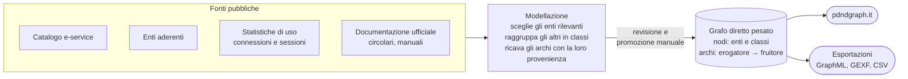

<div align="center">

**Italiano** · [English](README.en.md)


# PDND E-Services Graph

**La rete dell'interoperabilità italiana, resa navigabile.**

Chi eroga quali dati, a chi, e con quali volumi: la Piattaforma Digitale Nazionale Dati<br>
come grafo interattivo, costruito su dati aperti ufficiali e con la provenienza dichiarata per ogni relazione.

[](https://www.pdndgraph.it)
[](https://doi.org/10.5281/zenodo.19989954)

[](https://www.gnu.org/licenses/agpl-3.0)


[](https://github.com/engineering87/pdnd-eservices-graph/issues)

[](https://github.com/engineering87/pdnd-eservices-graph)


<sub>Online su **[pdndgraph.it](https://www.pdndgraph.it)**, senza installazione né registrazione.</sub>

<br>

| **63** | **313** | **600** | **264** | **88,7%** |
|:---:|:---:|:---:|:---:|:---:|
| nodi, di cui 10 classi di enti | e-service | archi erogatore→fruitore | archi osservati nell'uso reale | copertura del catalogo |

<sub>Modello v2, snapshot del 26 novembre 2026. I nodi sono una selezione: vedi [Cosa rappresentano i nodi](#cosa-rappresentano-i-nodi).</sub>

</div>

---

## In breve

- **Esplora** la rete: oltre 9.800 enti aderenti condensati in 53 enti rappresentati singolarmente e 10 classi (Comuni, Scuole, Sanità, Regioni e le altre categorie ufficiali PagoPA), con i loro e-service.
- **Distingui le prove**: ogni arco dichiara se viene da documentazione ufficiale, dall'uso registrato dalla PDND, dal catalogo, dal modello precedente o da una stima.
- **Riusa i dati**: grafo esportabile in GraphML, GEXF e CSV, pronto per Gephi, NetworkX, R o un foglio di calcolo.

> [!IMPORTANT]
> **Se usi questo strumento, citalo.** Chi riprende grafo, dati, esportazioni, analisi o immagini di PDND E-Services Graph, in una pubblicazione, una tesi, un report, una presentazione o un altro progetto, deve citare:
>
> **Del Re, F. (2026). *The PDND E-Service Network: A Graph-Based Model from Italian Open Government Data*. Zenodo. [doi:10.5281/zenodo.19989954](https://doi.org/10.5281/zenodo.19989954)**
>
> BibTeX e dettagli in [Come citare](#come-citare).

> [!NOTE]
> **Il grafo è una fotografia datata.** Enti, e-service e connessioni cambiano ogni giorno. Il grafo pubblicato fotografa il **26 novembre 2026**; il report Zenodo descrive il modello v1 del 2 maggio 2026. I numeri correnti sono su [interop.pagopa.it/numeri](https://www.interop.pagopa.it/numeri). Citando dati di questo progetto, indica sempre la data dello snapshot.

## Indice

| Capire | Approfondire | Usare | Partecipare |
|---|---|---|---|
| [Perché questo progetto](#perché-questo-progetto) | [Il modello](#il-modello) | [Funzionalità](#funzionalità) | [Contribuire](#contribuire) |
| [Cosa emerge dal grafo](#cosa-emerge-dal-grafo) | [Fonti e provenienza](#fonti-e-provenienza) | [Esportazione dei dati](#esportazione-dei-dati) | [**Come citare**](#come-citare) |
| | [Aggiornamento dei dati](#aggiornamento-dei-dati) | [Sviluppo](#sviluppo) | [Licenza](#licenza) |

## Perché questo progetto

La PDND è il pilastro dell'interoperabilità tra le Pubbliche Amministrazioni italiane: consente lo scambio sicuro e standardizzato di dati tramite API e rende concreto il principio *once only*, per cui la PA non chiede a cittadini e imprese dati che già possiede.

Al 24 novembre 2026 PagoPA dichiara **9.826 enti aderenti**, **15.291 e-service**, **55.504 connessioni** e **1,87 miliardi di sessioni di scambio**. A questa scala è difficile avere una visione d'insieme: chi eroga quali servizi? Chi li fruisce? Quanto è interconnessa la rete?

Il progetto rende quella rete **visibile e navigabile**, per chiunque voglia capire come circolano i dati nella Pubblica Amministrazione: funzionari pubblici, sviluppatori, ricercatori, cittadini.

I dataset aperti della PDND pubblicano il catalogo degli e-service e le statistiche di connessioni e sessioni per categoria di ente, ma non le coppie puntuali erogatore–fruitore. Il grafo ricostruisce quelle relazioni dalle fonti pubbliche disponibili, dichiarando per ciascuna da dove viene. Il progetto vuole anche incoraggiare la pubblicazione di quelle coppie come dato aperto.

## Cosa emerge dal grafo

Valori calcolati sul modello v2 e riproducibili con `npm run audit`; tra parentesi il valore del v1. Vanno letti sul modello, non sull'universo degli aderenti.

**La rete è fortemente asimmetrica.** ANPR (Ministero dell'Interno) eroga verso 53 dei 62 altri nodi (v1: 34 su 50) e ne fruisce da 12: è il profilo dell'hub erogatore. All'estremo opposto, Comune di Roma, Comune di Napoli e tutte le classi di enti tranne i Comuni hanno grado in uscita zero: fruiscono soltanto.

**Tre erogatori reggono quasi un quarto della rete.** ANPR, INPS e Agenzia delle Entrate concentrano il 22,5% dei 600 archi (v1: 24,5% di 343). La densità è 0,1536, circa un sesto delle connessioni possibili tra i nodi rappresentati: l'interoperabilità passa ancora da pochi snodi centrali.

**Alcuni enti sono cerniere, non estremità.** INPS eroga verso 50 nodi e fruisce da 36: è al centro del welfare sia come fonte sia come consumatore. Il nodo dei Comuni mostra il pattern complementare, con 43 archi in ingresso e 14 in uscita, come ci si aspetta da un nodo che raccoglie migliaia di enti fruitori.

**Abilitazione e uso sono misure diverse.** Un arco certificato dice che una classe di enti può usare un servizio, un arco osservato che lo usa: nel modello i primi sono 630, i secondi 264. Gli archi osservati mostrano dove passano i volumi, per esempio oltre 150 milioni di sessioni dai servizi ANPR verso i Comuni. Le classifiche ufficiali elencano però solo i primi 10 e-service per categoria, quindi un servizio senza arco osservato non è per forza poco usato.

**I cluster tematici corrispondono ai domini della PA.** Già nel modello v1 welfare (INPS, Comuni, Ministero del Lavoro), fisco (Agenzia delle Entrate, MEF, Sogei) e trasparenza (ANAC, AgID) si separavano nel layout, senza che le categorie fossero usate per posizionare i nodi.

I nodi ad alta centralità sono quelli la cui indisponibilità avrebbe effetto su molti altri enti. Una densità che cresce nel tempo indicherebbe che l'interoperabilità si sta distribuendo su più enti invece di concentrarsi.

## Funzionalità

**Primo accesso**
- Schermata di benvenuto con i numeri ufficiali della PDND e domande pronte ("Quali servizi usano i Comuni?", "Qual è il servizio più usato?"…)
- Finestra **Il progetto** con cosa mostra la mappa, come leggerla e come citarla
- Parole tecniche spiegate in una riga al passaggio del mouse o al tocco, e un glossario nella Guida

**Esplorazione**
- Grafo force-directed interattivo: trascinamento dei nodi, zoom con la rotella, spostamento della vista
- Mappa leggibile: nodi che non si sovrappongono, etichette senza sovrapposizioni che si infittiscono con lo zoom, adattamento automatico allo schermo e pulsante **Centra**, legenda dei colori per famiglie
- Filtro per categoria dalla legenda e ricerca testuale degli enti
- Pannello dettagli con gli e-service erogati e fruiti da ogni ente e, per le classi, il numero di aderenti
- **Dentro la classe**: per ogni classe di enti, i tipi di ente che la compongono (per esempio ASL, aziende ospedaliere e IRCCS nella Sanità) con gli aderenti e gli e-service abilitati solo a quel tipo, chi pubblica più e-service e la ricerca fra i suoi enti
- Apertura di una classe nella mappa: accanto alla classe compaiono i suoi tipi di ente, con le abilitazioni del catalogo rivolte solo a loro; l'uso osservato resta sulla classe, perché è pubblicato per categoria ([esempio](https://www.pdndgraph.it/ente/sanita_agg?aperte=sanita_agg))
- Link diretti a ogni vista e a ogni ente, per esempio [pdndgraph.it/ente/inps](https://www.pdndgraph.it/ente/inps)

**Accessibilità e temi**
- Tema chiaro e tema scuro, con un pulsante nell'intestazione; al primo accesso segue la preferenza del sistema
- Colori del testo verificati sul contrasto WCAG 2.1 AA (almeno 4,5:1) in entrambi i temi
- Uso da tastiera: link «Vai al contenuto», ricerca di un ente con suggerimenti e apertura con Invio, finestre di dialogo che trattengono il fuoco e si chiudono con Esc
- Rispetto della preferenza «riduci movimento» e tabelle con intestazioni dichiarate per i lettori di schermo

**Relazioni fra enti** (scheda Relazioni)
- Tutte le relazioni erogatore → e-service → fruitore in tabella, filtrabili per erogatore, fruitore, categoria, provenienza e testo
- Riepilogo raggruppato per erogatore, fruitore, categoria, e-service o provenienza, con enti abilitati e sessioni osservate
- Percorsi pronti ("Cosa usano i Comuni", "Chi usa i servizi ANPR"…), viste filtrate condivisibili via link e download in CSV
- Scheda di ogni e-service ([esempio](https://www.pdndgraph.it/eservice/pagopa_cfc8a94d)): erogatore, fruitori per provenienza, enti abilitati e sessioni, identificativo del catalogo, altri servizi dello stesso erogatore

**Il tuo ente** (scheda Il tuo ente)
- Ricerca per nome o codice IPA fra gli enti pubblici aderenti alla PDND, oltre 10.000 voci dell'elenco ufficiale: comuni, scuole, aziende sanitarie, università, gestori di servizi pubblici. Imprese e altri privati sono contati nelle classi ma non elencati uno per uno
- Per ogni ente: tipo di ente, e-service che pubblica (con il link alla scheda quando l'e-service è nella mappa), servizi usati dagli enti del suo tipo e collegamenti alla mappa e alla scheda Relazioni
- Link condivisibile alla scheda di un ente, per esempio [pdndgraph.it/enti?ente=c_e506](https://www.pdndgraph.it/enti?ente=c_e506)

**Lettura dei dati**
- Frecce direzionali erogatore→fruitore, spessore proporzionale ai servizi condivisi
- Colori per famiglia istituzionale: Ministero, Regione, Previdenza, Fisco, Digitale e altre
- Provenienza visibile: archi osservati in azzurro, ricostruiti e inferiti tratteggiati
- Filtro per provenienza, dal menu o dalla legenda: per esempio solo l'uso osservato ([pdndgraph.it/?archi=osservata](https://www.pdndgraph.it/?archi=osservata)) o solo le fonti ufficiali
- Enti abilitati e sessioni di scambio degli e-service, dove i dati ufficiali li riportano

**Numeri ed esportazione** (scheda Numeri)
- Andamento della PDND dal 2022: enti aderenti e sessioni di scambio mese per mese, con i totali ufficiali e la variazione dell'ultimo mese
- Andamento dei singoli servizi: sessioni degli ultimi 12 e 6 mesi e confronto con i 6 mesi precedenti, nella scheda di ogni e-service e nei servizi in crescita o in calo
- **Cosa è cambiato**: confronto del grafo attuale con le istantanee mensili (dal 1° giugno 2026) o con il modello v1 del report: nuovi legami, legami scomparsi, servizi entrati e usciti, servizi con più nuove sessioni
- E-service più adottati e più usati, archi per provenienza, classi di enti
- Analisi di rete: matrice erogatori × classi di enti raggiunte, enti ponte (centralità di intermediazione), reciprocità e distribuzione dei gradi
- **Comunità della rete**: gruppi di enti che si scambiano dati soprattutto fra loro, trovati con il metodo di Louvain, con la modularità e la quota di legami interni di ogni gruppo
- **La rete nel tempo**: relazioni distinte, densità, reciprocità, concentrazione sui primi erogatori, intermediazione e modularità per ogni istantanea mensile
- Esportazione in GraphML, GEXF e CSV direttamente dal browser
- Schede Metodologia e Guida integrate nell'app

## Il modello

### In numeri

| Metrica | v2 (26 novembre 2026) | v1 (2 maggio 2026, report) |
|---|---|---|
| Nodi | **63** (53 enti + 10 classi di enti) | 51 (50 enti + 1 aggregato) |
| E-service | **313** | 86 tipi di servizio |
| Archi distinti erogatore→fruitore | **600** | 343 |
| Relazioni erogatore–fruitore | **1.476** | 570 |
| Densità | **0,1536** | 0,1345 |
| Copertura del catalogo ufficiale | **88,7%** di 15.301 record | ~89% di 14.102 endpoint |

Per ruolo: 48 nodi erogatori e fruitori, 12 solo fruitori, 3 solo erogatori. Per categoria: 21 Regione, 8 Classi aggregate, 7 Ministero, 6 Comune, 4 Fisco, 2 ciascuna Digitale, Trasporti, Tecnologia, Statistica e Società pubblica, 1 ciascuna Previdenza, Lavoro, Imprese, Anticorruzione, Cultura, Comuni Aggregati e Regioni Aggregate.

### Cosa rappresentano i nodi

> [!IMPORTANT]
> **63 non è il numero degli enti aderenti alla PDND**, che sono quasi 10.000: è il numero dei nodi di un modello che seleziona alcuni enti e aggrega tutti gli altri.

| | Cosa contiene |
|---|---|
| **53 nodi individuali** | Ministeri, enti previdenziali e fiscali, autorità, società pubbliche, 21 Regioni e Province Autonome, 6 grandi Comuni |
| **10 classi di enti** | Tutti gli altri aderenti, raccolti per categoria ufficiale PagoPA |

| Classe | Aderenti | | Classe | Aderenti |
|---|---:|---|---|---:|
| Comuni | 7.657 | | Enti privati | 306 |
| PA centrali | 415 | | Università e AFAM | 172 |
| Scuole | 381 | | Sanità | 123 |
| Altre PA locali | 350 | | Province e Città metropolitane | 99 |
| Gestori di pubblici servizi e stazioni appaltanti | 343 | | Regioni | 21 |

**Aggregazione.** Gran parte degli endpoint del catalogo sono servizi standard replicati da ogni Comune: Albo Pretorio, SUAP, Protocollo, Demografici, Tributi, Civici, WaaS, IoT, Trasparenza. I 9 e-service attribuiti al nodo dei Comuni corrispondono a circa 6.380 endpoint del catalogo. Rappresentarli uno per uno produrrebbe migliaia di nodi quasi identici senza aggiungere informazione sulla struttura della rete. Lo stesso criterio vale per i fruitori: una categoria di enti dichiarata dal catalogo o dalle statistiche ufficiali va sul nodo di classe, mai su un campione di enti scelti dal progetto.

**Selezione.** Il catalogo conta oltre 6.000 producer distinti. Il modello ne rappresenta singolarmente 53, scelti per il loro ruolo nella rete: gli hub erogatori nazionali (i 10 erogatori con più connessioni ufficiali ci sono tutti), gli enti con ruolo strutturale nei domini della PA, le Regioni e Province Autonome e i Comuni che erogano servizi propri.

Grado, centralità e densità sono quindi calcolati **su questo insieme**, non sull'universo degli aderenti: un grado in uscita di 53 significa "eroga verso 53 dei 62 altri nodi", alcuni dei quali rappresentano migliaia di enti. Sono indicatori della struttura della rete rappresentata, non censimenti. Criteri completi in [METODOLOGIA.md §3](METODOLOGIA.md#3-scelte-di-rappresentazione-e-aggregazioni) e [§7.2](METODOLOGIA.md#72-classi-di-enti).

> [!NOTE]
> 55 dei 313 record in `eservices`, quelli senza `catalogId`, rappresentano un **tipo di servizio** del modello v1 e non un singolo endpoint del catalogo. Vedi [METODOLOGIA.md §3.5](METODOLOGIA.md#35-tipi-di-servizio-service-type-vs-endpoint-del-catalogo).

### Come è costruito il grafo

Dai dati aperti della piattaforma al grafo, in quattro passaggi:



L'interoperabilità è un problema di rete: soggetti che producono dati e soggetti che li consumano, collegati da accordi e interfacce. Un elenco risponde alla domanda "quali servizi esistono"; un grafo risponde anche a "che forma ha la rete che ne risulta".

Il modello è un **grafo diretto pesato**: un arco da A a B indica che A eroga almeno un e-service fruito da B, e il peso conta i servizi condivisi sulla coppia. La direzione conta: che INPS eroghi verso i Comuni non implica il contrario.

La visualizzazione usa un layout force-directed (Fruchterman-Reingold), che dispone i nodi come un sistema di molle e repulsioni fino all'equilibrio: la topologia emerge senza posizionamento manuale. Le formule di grado, centralità e densità sono in [METODOLOGIA.md](METODOLOGIA.md).

## Fonti e provenienza

| Dato | Fonte | Natura |
|---|---|---|
| Enti | [`aderenti.csv`](https://github.com/italia/pdnd-opendata), dati.gov.it | ✅ Dato aperto ufficiale |
| E-service | [`eservice_a_catalogo.csv`](https://github.com/italia/pdnd-opendata), dati.gov.it | ✅ Dato aperto ufficiale |
| Adozione e uso | [Classifiche di enti abilitati e sessioni](https://github.com/italia/pdnd-opendata) per categoria di ente, `totale_enti.csv` | ✅ Dato aperto ufficiale, aggregato |
| Relazioni (archi) | Classifiche ufficiali, campo `attributes.certified`, circolari, manuali operativi | ⚠️ Ricostruzione con provenienza per arco |

> [!CAUTION]
> **Le coppie puntuali non sono un dato aperto.** La PDND pubblica connessioni e sessioni solo aggregate per categoria di ente fruitore: da queste derivano gli archi *osservati* verso le classi di enti, con valori che sono minimi garantiti. Le altre relazioni sono ricostruite dal campo `attributes.certified` del catalogo e da documentazione ufficiale pubblica: circolari ANPR DAIT n. 73/2023 e n. 61/2025, presentazione ANCI/DTD sui 26 casi d'uso, manuale operativo SSU Unioncamere, documentazione I.PaC, approfondimenti tecnici.

Ogni arco porta un campo `origine`, così chi usa il dato sa da dove viene ogni relazione. Quando più fonti sostengono lo stesso arco vale la più forte, nell'ordine della tabella:

| Origine | Significato | Archi |
|---|---|---:|
| `documentata` | Fonte ufficiale puntuale: norme, circolari, manuali, presentazioni | 12 |
| `osservata` | Connessioni o sessioni realmente registrate dalla PDND verso una classe di enti | 264 |
| `certificata` | Classe di enti abilitata dal campo `attributes.certified` del catalogo | 630 |
| `ricostruita` | Relazione del modello v1, ricostruita da documentazione pubblica senza fonte per singolo arco | 545 |
| `inferita` | Stima AI congelata, usata solo quando manca ogni altra prova | 25 |

Delle 570 relazioni del v1, tutte conservate, 25 trovano conferma nei dati ufficiali (18 certificate, 7 osservate). Gli archi inferiti sono stime, non fatti documentati; tutte le fonti del progetto sono pubbliche. Metodologia completa in [METODOLOGIA.md](METODOLOGIA.md), modello v2 nella [sezione 7](METODOLOGIA.md#7-modello-v2-novembre-2026).

## Aggiornamento dei dati

Il catalogo cresce con l'adesione di nuovi enti e la pubblicazione di nuovi e-service, gli stati passano da Attivo a Sospeso e viceversa e le versioni delle API si succedono. Per separare l'automazione dal dato pubblicato, il progetto mantiene tre livelli:

| Livello | File | Aggiornato al | Contenuto |
|---|---|---|---|
| **Grafo live** (v2) | `src/data/pdnd-data.json` | 26 novembre 2026 | 63 nodi, 313 e-service, 600 archi |
| **Anteprima** (automatica) | `pipeline/pdnd-data.preview.json` | 26 novembre 2026 | allineata al grafo live |
| **Snapshot v1** (report) | `src/data/snapshots/pdnd-data.2026-05-02.json` | 2 maggio 2026 | 51 nodi, 86 tipi di e-service, 343 archi, congelato |

Una GitHub Action mensile rigenera l'anteprima e apre una pull request su `develop` con il report di esecuzione. L'anteprima **non sostituisce** il grafo live: la promozione è manuale, passa da un'altra pull request e arriva sul sito con la release. Così un cambiamento automatico del catalogo non può cancellare relazioni ricostruite e documentate a mano. Le 570 relazioni del v1 vivono in `pipeline/connections-reconstructed.json` e confluiscono in ogni anteprima; un test verifica che nessuna coppia erogatore→fruitore del v1 vada persa.

Per ogni ente la pipeline sceglie gli e-service più rilevanti secondo le classifiche ufficiali, cioè il maggiore fra enti abilitati e sessioni di scambio; i campi `enti_abilitati_min` e `sessioni_min` ne riportano i minimi garantiti. Ogni fruitore compare una volta per e-service, con la provenienza più forte; connessioni e sessioni osservate accompagnano l'arco qualunque sia la sua provenienza.

```bash
node pipeline/build-graph-data.mjs           # dry-run: scarica, calcola, stampa il report
node pipeline/build-graph-data.mjs --write   # aggiorna l'anteprima, il grafo live resta intatto
node pipeline/build-graph-data.mjs --no-ai   # senza inferenza
npm run compare-catalog                      # copertura del modello rispetto al catalogo vivo
```

Il report di esecuzione (`pipeline/last-run-report.md`) riporta il numero di righe del catalogo, gli e-service nuovi e rimossi, gli archi per provenienza, le classi di enti con i loro aderenti e gli e-service curati non più pubblicati.

**Inferenza assistita.** Le stime AI sono congelate in `pipeline/connections-frozen.json`: ogni build è deterministica e non chiama alcun modello. L'inferenza a runtime gira solo sui `catalogId` elencati in `pipeline/inference-allowlist.json`, vuota per impostazione predefinita, con vocabolario controllato (solo nodi esistenti), soglia di confidenza (`INFERENCE_MIN_CONF`, default 0,55), cache per `catalogId`, temperatura 0 e prosecuzione senza AI se l'API non risponde. Variabili e dettagli in [pipeline/README.md](pipeline/README.md).

## Esportazione dei dati

Il modello è disponibile in formati standard per l'analisi di rete, senza dover interpretare il JSON del progetto. I file sono nella cartella [`exports/`](exports/), rigenerabile con `npm run export`, e si scaricano anche dalla scheda **Numeri** dell'app, che li genera nel browser senza chiamate di rete.

| Formato | File | Aperto con |
|---|---|---|
| GraphML | `pdnd-eservices-graph-graphml.graphml` | Gephi, NetworkX, igraph, yEd |
| GEXF | `pdnd-eservices-graph-gexf.gexf` | Gephi |
| CSV nodi | `pdnd-eservices-graph-nodi-csv.csv` | Fogli di calcolo, R, pandas |
| CSV archi | `pdnd-eservices-graph-archi-csv.csv` | Fogli di calcolo, R, pandas |

Il grafo è **diretto e pesato**: un arco da *a* a *b* significa che *a* eroga almeno un e-service consumato da *b*, e il peso è il numero di e-service distinti sulla coppia, come nel report pubblicato.

<details>
<summary><b>Attributi di nodi e archi</b></summary>

**Nodi**

| Campo | Tipo | Significato |
|---|---|---|
| `label` | stringa | Nome dell'ente |
| `categoria` | stringa | Famiglia istituzionale (Ministero, Regione, Fisco, ...) |
| `tipo` | stringa | Ruolo prevalente: erogatore, fruitore o entrambi |
| `aggregato` | booleano | `true` se il nodo rappresenta una classe di enti |
| `aderenti` | intero | Numero di enti aderenti della classe (solo nodi aggregati) |
| `descrizione` | stringa | Nota descrittiva |

**Archi**

| Campo | Tipo | Significato |
|---|---|---|
| `weight` | intero | Numero di e-service distinti sull'arco |
| `origine` | stringa | Provenienza: `documentata`, `osservata`, `certificata`, `ricostruita` o `inferita`; se le provenienze sono più d'una sono separate da `\|` |
| `connessioni` | intero | Enti abilitati osservati sulla coppia (massimo fra gli e-service), minimo garantito |
| `sessioni` | intero | Sessioni di scambio osservate sulla coppia (somma fra gli e-service), minimo garantito |
| `servizi` | stringa | Nomi degli e-service che contribuiscono al peso, separati da `;` |

</details>

> [!WARNING]
> Due avvertenze, ripetute anche nei metadati dei file. Le coppie puntuali erogatore-fruitore **non sono pubblicate come open data**: gli archi derivano da statistiche aggregate, catalogo e documentazione, e il campo `origine` ne dichiara la natura. I nodi con `aggregato=true` rappresentano classi di enti (`comuni_agg` vale circa 7.650 Comuni): le misure di grado **non sono confrontabili** con quelle di un grafo in cui ogni ente è un nodo distinto. Per escluderli basta filtrare su quel campo.

<details>
<summary><b>Esempi con NetworkX e pandas</b></summary>

```python
import networkx as nx

G = nx.read_graphml("pdnd-eservices-graph-graphml.graphml")
print(G.number_of_nodes(), G.number_of_edges())   # 63 600
print(round(nx.density(G), 4))                    # 0.1536

# Enti che servono il maggior numero di controparti
for n, d in sorted(G.out_degree, key=lambda x: -x[1])[:3]:
    print(G.nodes[n]["label"], d)
# Min. Interno (ANPR) 53
# INPS 50
# Agenzia delle Entrate 32

# Sottografo senza i nodi aggregati, per misure di grado confrontabili
reale = G.subgraph([n for n, d in G.nodes(data=True) if not d["aggregato"]])
print(reale.number_of_nodes(), reale.number_of_edges())   # 53 376
```

```python
import pandas as pd

archi = pd.read_csv("pdnd-eservices-graph-archi-csv.csv")
nodi  = pd.read_csv("pdnd-eservices-graph-nodi-csv.csv")

# Composizione per provenienza degli archi
print(archi["origine"].value_counts())

# Enti per numero totale di servizi erogati
nome = nodi.set_index("id")["label"]
print(archi.groupby("Source")["Weight"].sum().sort_values(ascending=False).head(3).rename(index=nome))
# Min. Interno (ANPR)      267
# INPS                     140
# Agenzia delle Entrate    101
```

In **Gephi** basta aprire il file `.gexf`, oppure importare i due CSV dal laboratorio dati: l'intestazione degli archi usa già `Source`, `Target`, `Weight`, `Type`.

</details>

Le esportazioni sono **deterministiche**: a parità di dato i file sono identici byte per byte, perché la data dello snapshot è letta dal modello e non dall'orologio. I test verificano che i file in `exports/` corrispondano al dato corrente. Dati di origine CC0 1.0, codice AGPL-3.0; se usi questi file in una pubblicazione, [cita il progetto](#come-citare).

## Sviluppo

### Quick start

```bash
git clone https://github.com/engineering87/pdnd-eservices-graph.git
cd pdnd-eservices-graph
npm install
npm run dev        # http://localhost:3000
```

| Comando | Cosa fa |
|---|---|
| `npm run dev` / `npm run build` | Avvio in sviluppo / build di produzione |
| `npm run lint` | Controllo statico del codice |
| `npm test` | Invarianti del modello, conservazione del v1, allineamento delle esportazioni |
| `npm run test:e2e` | Test end-to-end con Playwright: l'app vera in Chromium, su desktop e smartphone (la prima volta: `npx playwright install chromium`) |
| `npm run audit` | Audit del JSON: conteggi, gradi, controlli di coerenza |
| `npm run compare-catalog` | Copertura del modello rispetto al catalogo ufficiale |
| `npm run export` | Rigenera GraphML, GEXF e CSV in `exports/` |
| `npm run update-data` | Riepilogo del catalogo PDND, utile per scoprire nuovi erogatori |
| `npm run paper-metrics` | Snippet pgfplots/LaTeX per il report Zenodo |

Dettagli sugli script in [scripts/README.md](scripts/README.md).

La build (`npm run build`) scrive anche una pagina per ogni ente ed e-service con titolo, descrizione e immagine di anteprima propri (`scripts/prerender-meta.mjs`), così i link condivisi mostrano il contenuto giusto anche ai servizi che non eseguono JavaScript.

### Aggiornare enti e relazioni

Il grafo live è generato dalla pipeline: le modifiche durature vanno nei file di `pipeline/`, non direttamente in `src/data/pdnd-data.json`, che verrebbe sovrascritto alla promozione successiva.

- **Nuovo ente**: una voce in `pipeline/entities.json` con i suoi codici IPA ([formato](pipeline/README.md#aggiungere-unentità-tracciata)); per una categoria nuova, il colore in `src/constants/colors.js`.
- **Nuova classe di enti**: una voce in `pipeline/classi.json`.
- **Nuova relazione documentata**: il `catalogId` dell'e-service con i nodi fruitori in `pipeline/connections-overrides.json`, citando la fonte pubblica. Gli archi così aggiunti hanno origine `documentata`.

```bash
node pipeline/build-graph-data.mjs --write                  # aggiorna l'anteprima
cp pipeline/pdnd-data.preview.json src/data/pdnd-data.json  # promozione
cp pipeline/aderenti-index.preview.json src/data/aderenti-index.json
npm run export && npm test
```

### Struttura del progetto

<details>
<summary>Albero delle cartelle</summary>

```
pdnd-eservices-graph/
├── .github/workflows/
│   ├── azure-static-web-apps-polite-plant-07967ad10.yml  # CI/CD per Azure
│   ├── ci.yml                                            # Lint, test, build ed end-to-end (main e develop)
│   ├── codeql.yml                                        # Analisi di sicurezza CodeQL (main e develop)
│   ├── dependabot.yml                                    # (in .github/) aggiornamenti delle dipendenze su develop
│   ├── update-graph-data.yml                             # Pipeline dati mensile
│   └── promote-graph-data.yml                            # Promozione manuale dell'anteprima
├── docs/
│   └── demo.gif
├── exports/                             # GraphML, GEXF, CSV (npm run export)
├── pipeline/                            # ← Aggiornamento automatico del catalogo
│   ├── build-graph-data.mjs             # Script di build del grafo
│   ├── infer-connections.mjs            # Motore di inferenza (disattivo di default)
│   ├── entities.json                    # Registro entità tracciate (codici IPA)
│   ├── classi.json                      # Classi di enti (nodi aggregati)
│   ├── category-map.json                # Mappa attributes.certified → nodi
│   ├── connections-overrides.json       # Connessioni documentate
│   ├── connections-reconstructed.json   # Relazioni del modello v1
│   ├── connections-frozen.json          # Stime AI congelate
│   ├── pdnd-data.preview.json           # Anteprima generata (NON è il dato live)
│   ├── aderenti-index.preview.json      # Indice di tutti gli aderenti (anteprima)
│   ├── last-run-report.md               # Report dell'ultima esecuzione
│   └── README.md
├── public/                              # favicon e logo
├── e2e/                                 # Test end-to-end (Playwright)
├── scripts/                             # audit, confronto, test, export, metriche del report
├── src/
│   ├── components/                      # PDNDGraph, GraphView, StatsView, MethodologyView, GuideView…
│   ├── constants/colors.js              # Palette delle categorie
│   ├── utils/                           # Costruzione del grafo, esportazioni, stato URL
│   ├── data/
│   │   ├── pdnd-data.json               # ← DATI LIVE (modello v2)
│   │   ├── aderenti-index.json          # Tutti gli aderenti, per la scheda Il tuo ente
│   │   ├── network-history.json         # Misure di rete nel tempo (npm run export)
│   │   └── snapshots/                   # Modello v1 del report e istantanee mensili
│   ├── App.jsx
│   ├── index.css
│   └── main.jsx
├── index.html
├── package.json
├── playwright.config.js               # Configurazione dei test end-to-end
├── staticwebapp.config.json             # Config Azure Static Web Apps
├── vite.config.js
├── ADDITIONAL-TERMS.md                  # Termine di attribuzione AGPL 7(b)
├── CITATION.cff
├── METODOLOGIA.md                       # ← Fonti, metodologia, limitazioni
└── README.md
```

</details>

### Tecnologie

**React 19** per l'interfaccia, **Vite 8** per la build, **Canvas 2D** per il rendering del grafo senza librerie esterne, **Azure Static Web Apps** per l'hosting e **GitHub Actions** per CI, analisi CodeQL e pipeline dati mensile.

L'app non contatta altri siti: i caratteri (Titillium Web e Roboto Mono, licenza OFL) sono ospitati insieme al sito, non ci sono strumenti di statistica e una Content Security Policy consente solo risorse del sito stesso. I test end-to-end falliscono se una pagina prova a caricare qualcosa da fuori.

## Contribuire

Le pull request sono benvenute, in particolare le correzioni alle relazioni erogatore→fruitore accompagnate dal riferimento alla fonte pubblica che le documenta.

1. Fai un fork del repository e crea un branch (`git checkout -b feature/nuovo-ente`)
2. Modifica i file di `pipeline/` o i componenti
3. Esegui `npm run lint`, `npm test`, `npm run test:e2e` e `npm run audit`
4. Apri una pull request

## Come citare

**Ogni uso del progetto va accompagnato dalla citazione del report tecnico**, indicando anche la data dello snapshot dei dati usati.

La metodologia è documentata nel report tecnico, distribuito con licenza CC-BY-4.0, che descrive il modello v1: fonti, pipeline di ricostruzione, ruolo dei modelli linguistici come strumento di estrazione e copertura misurata (~89% di 14.102 endpoint). Il sorgente LaTeX è in [pdnd-graph-paper](https://github.com/engineering87/pdnd-graph-paper).

> Del Re, F. (2026). *The PDND E-Service Network: A Graph-Based Model from Italian Open Government Data*. Zenodo, v1.0.0, 3 maggio 2026. [doi:10.5281/zenodo.19989954](https://doi.org/10.5281/zenodo.19989954)

```bibtex
@techreport{delre2026pdnd,
  author      = {Del Re, Francesco},
  title       = {The {PDND} E-Service Network: A Graph-Based Model from
                 Italian Open Government Data},
  institution = {Zenodo},
  year        = {2026},
  month       = {5},
  doi         = {10.5281/zenodo.19989954},
  url         = {https://doi.org/10.5281/zenodo.19989954},
  version     = {1.0.0}
}
```

GitHub genera la citazione anche dal pulsante **Cite this repository**, a partire da [`CITATION.cff`](CITATION.cff). I numeri del report si riferiscono al modello v1, quelli di questo README al modello v2: indica sempre la data dello snapshot che usi.

> [!NOTE]
> **Su cosa si basa la citazione.** Il report è sotto **CC-BY-4.0**: chi ne riprende contenuti deve attribuirli all'autore. Il codice è sotto **AGPL-3.0**: chi lo usa o lo modifica deve conservare le note di copyright e di licenza e rilasciare le opere derivate con la stessa licenza. La citazione del report è la forma con cui l'autore chiede di riconoscere ogni uso del progetto, e permette a chi legge di risalire alla metodologia e ai suoi limiti.

## Licenza

Il codice è distribuito sotto licenza **AGPL-3.0** (vedi [LICENSE](LICENSE)), con un termine aggiuntivo di attribuzione ai sensi della sezione 7(b) (vedi [ADDITIONAL-TERMS.md](ADDITIONAL-TERMS.md)):

- puoi **usare, modificare e distribuire** liberamente il codice;
- se **distribuisci una versione modificata**, devi renderla disponibile con la stessa licenza;
- se **la offri come servizio in rete** (per esempio una web app), devi rendere disponibile agli utenti il codice sorgente della versione in esecuzione;
- in ogni copia, versione modificata o servizio in rete devi **conservare l'attribuzione all'autore e la citazione del report**, nel codice e nel piè di pagina dell'interfaccia.

I dati sugli e-service provengono da [PDND Open Data](https://github.com/italia/pdnd-opendata) e sono distribuiti con licenza **CC0 1.0 Universal** (pubblico dominio) dalla Presidenza del Consiglio dei Ministri – Dipartimento per la Trasformazione Digitale.
